<p align="center">
  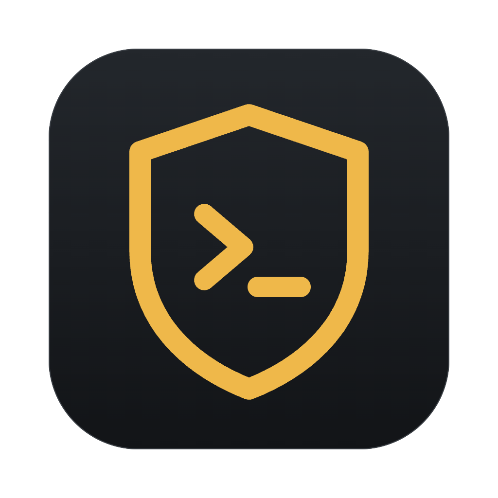
</p>

<h1 align="center">aiegis</h1>

<p align="center">
  A desktop app for AppSec code audits on top of <a href="https://docs.claude.com/en/docs/claude-code/overview">Claude Code</a> or <a href="https://pi.dev">pi</a>
</p>

<p align="center">
  <a href="https://github.com/seelentov/aiegis/releases/latest"></a>
  <a href="LICENSE"></a>
  
</p>

<p align="center">
  <a href="docs/getting-started.md"><b>Getting started</b></a> ·
  <a href="docs/README.md"><b>Documentation</b></a> ·
  <a href="docs/cli.md"><b>CLI reference</b></a> ·
  <a href="https://github.com/seelentov/aiegis/releases/latest"><b>Download</b></a>
</p>

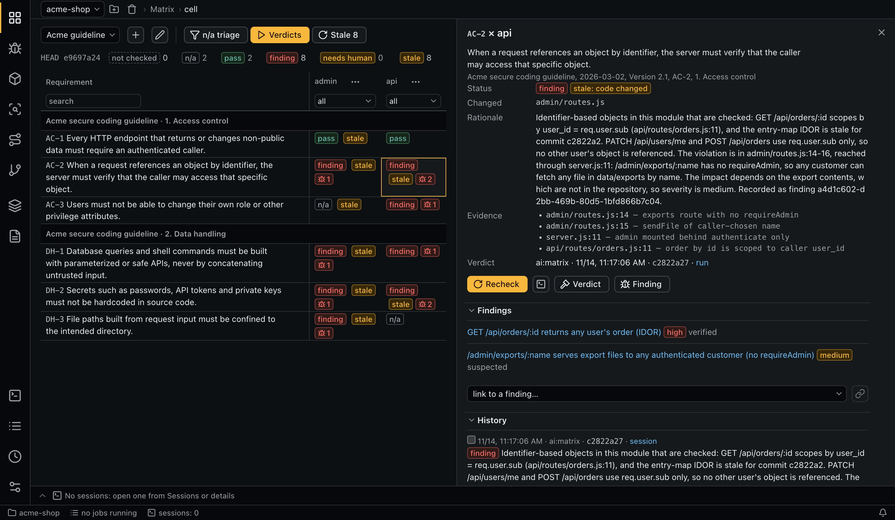

aiegis turns a repository security audit into a managed process. Requirements from standards and internal guidelines are laid out in a matrix of requirement × module, and background sessions of an AI agent deliver a verdict for each cell, with references to the code.

The app has no chat of its own. It starts your local coding agent, stores the data, prompts and configuration, and the agent reports through a built-in MCP server. By default the agent is `claude` (Claude Code).

> **Status: 0.x, an early version.** The data and configuration formats may change. macOS is the main platform; Windows and Linux builds are produced automatically and get less testing.

## Features

| Feature | What it does | Docs |
|---|---|---|
| **Modules** | Splits the repository into named sets of globs, by hand or by AI, and keeps their history | [Modules](docs/modules.md) |
| **Entry point maps** | HTTP, gRPC, GraphQL, queues, cron, CLI, WebSocket and plugins, with handler, middleware, authorization, parameters and call chains to sinks. Versioned by commit | [Entry points](docs/entry-points.md) |
| **Documents to requirements** | Uploads MD, PDF or DOCX, or lets AI write security documents from your code. AI extracts items with quotes, a person reviews them, and new versions show a diff | [Documents](docs/documents.md) |
| **Document refresher** | Checks document sets against their sources and proposes new editions, new documents, replacements and retirements. A person applies them, and unchanged sources cost no AI | [Document refresher](docs/document-refresher.md) |
| **Matrix** | An inexpensive `n/a` triage, then `pass`, `finding` or `needs_human` verdicts with reasons and code references. Runs by column, row or section, always after a token estimate | [Matrix](docs/matrix.md) |
| **Vulnerability hunt** | Reads every file of a module for exploitable flaws of any kind, beyond what the requirements name. Tracks which files were read, and the next hunt reads only unread and changed ones | [Modules](docs/modules.md#vulnerability-hunt) |
| **Findings** | A `suspected → verified, false_positive, accepted_risk, fixed` lifecycle, mandatory deduplication, merging, the data flow from attacker input to the sink, independent verification, and fix sessions | [Findings](docs/findings.md) |
| **SAST signals** | Semgrep, Gitleaks and Trivy run once per commit. Results are normalized and given to the agent as hints. Suppressions record a reason, author and expiry | [Signals](docs/signals.md) |
| **SCA** | An AI dependency inventory backed by tool reports, a prefilter without AI, and reachability per package. A reachable vulnerability becomes a finding | [SCA](docs/sca.md) |
| **PoC tester** | Starts a test instance from a worktree and checks a finding with requests only to `base_url`, in an OS sandbox. An agent can work out how to start your project | [PoC tester](docs/poc.md) |
| **Branch checks** | Checks a branch's changes, as a pull request shows them, against a document set before merging. Results stay separate from the audit | [Branch checks](docs/branch-check.md) |
| **Schedules** | Runs matrices, SCA, scanners, entry point maps, vulnerability hunts, document and branch checks and free-form tasks on cron, with token limits and history | [Schedules](docs/schedules.md) |
| **Freshness** | Each verdict is tied to a commit and its evidence files. Code changes mark it `stale`, so you recheck only that | [Concepts](docs/concepts.md#freshness-stale) |
| **Service and CLI** | One Linux executable runs without a window, and a CLI offers the same actions as the app | [Service and CLI](docs/service.md) |
| **Choice of agent** | Claude Code or pi, for the whole app, a project, a role or a module | [Agents](docs/agents.md) |
| **History** | Append-only runs with commit, configuration snapshot, session, tokens and cost. Any session can be reopened in the built-in terminal | [Queue and sessions](docs/queue-and-sessions.md) |

## How it works

- Background runs use `claude -p --output-format stream-json` or `pi --mode json` in a `git worktree` on a pinned commit, so your working tree is not touched.
- Each run gets its own token for the MCP server. The server knows the role and scope, and refuses writes outside the scope.
- Role permissions are written once, in Claude Code syntax. For pi, the aiegis extension enforces them on each tool call.
- Nothing is hardcoded: the agent, role prompts, permissions, models, effort, scanners and limits are in editable files, with a cascade of `global → project → role → module → matrix → item`.
- Data lives in `~/.aiegis/` (global settings), `<repo>/.aiegis/` (project settings, committed) and the app's data directory (`db.sqlite`, documents, worktrees).

See [Concepts](docs/concepts.md), [Configuration](docs/configuration.md) and [Security](docs/security.md).

## Screenshots

| | |
|---|---|
| 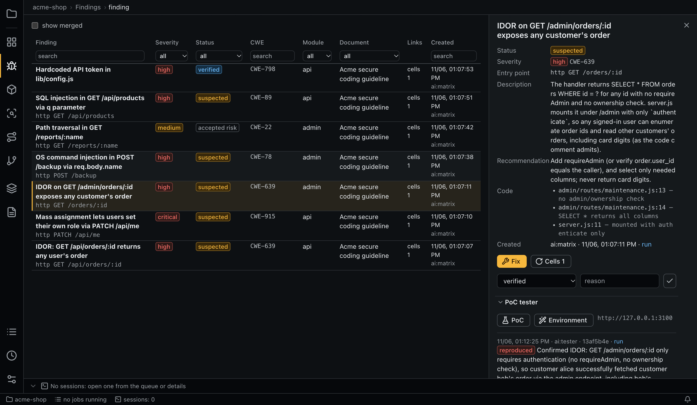 | 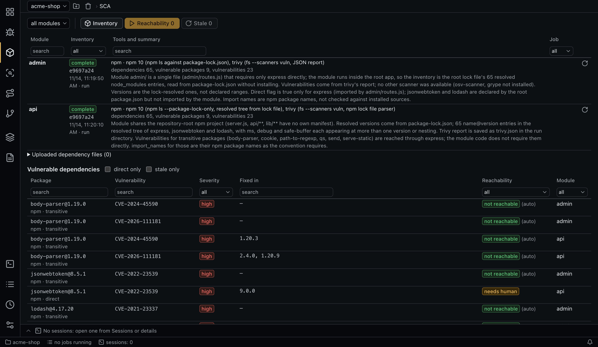 |
| Findings and the PoC tester | SCA |
| 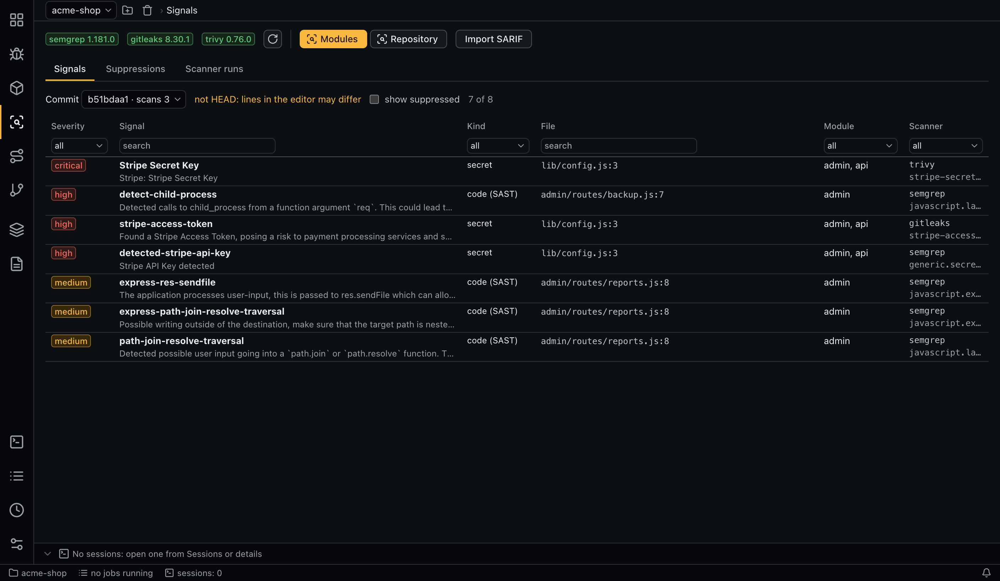 | 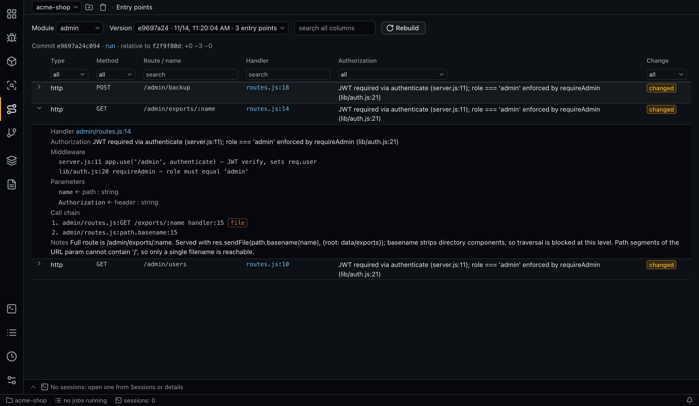 |
| Signals | Entry points |
| 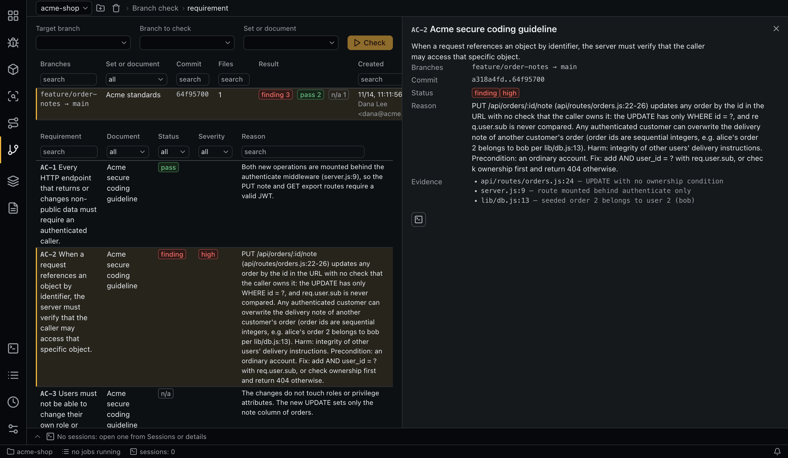 | 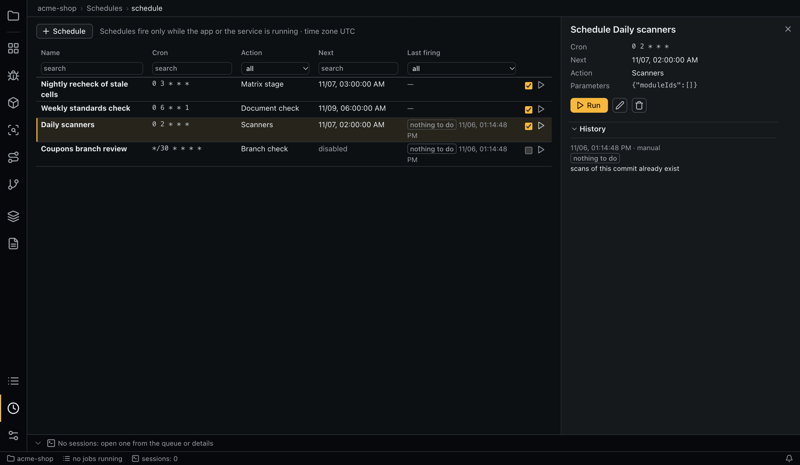 |
| Branch checks | Schedules |
| 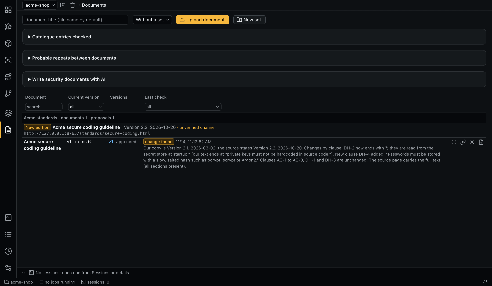 | 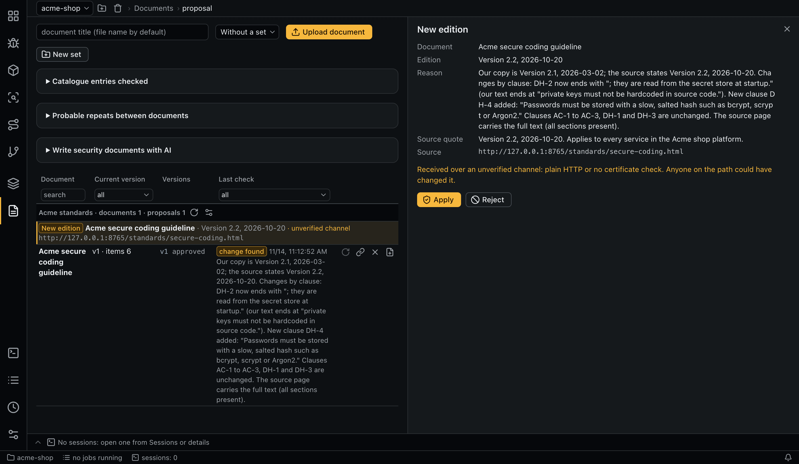 |
| Documents | Document refresher |
| 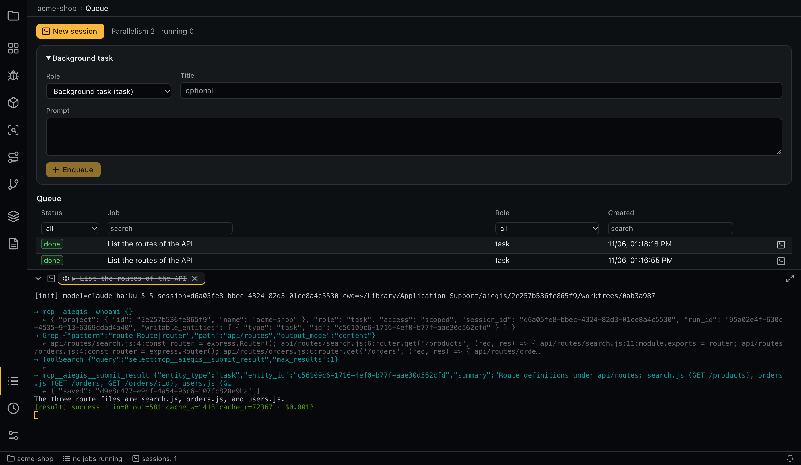 | 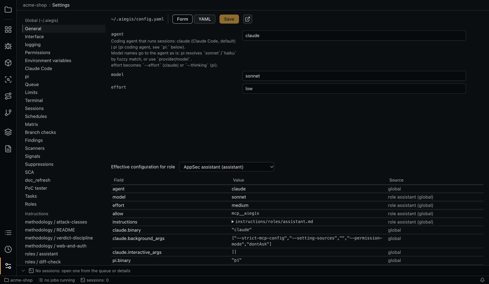 |
| Queue | Settings |

## Install

You need:

- [Claude Code](https://docs.claude.com/en/docs/claude-code/setup), installed and logged in (`claude` on `PATH`), which is the default agent. Or [pi](https://pi.dev) (`npm install -g @earendil-works/pi-coding-agent`, `pi` on `PATH`, a provider configured in pi) with `agent: pi` in `~/.aiegis/config.yaml`. See [Agents](docs/agents.md).
- `git`.
- Optionally, `semgrep`, `gitleaks` and `trivy` on `PATH`. Without them, those scanners are skipped.

Builds are on the [releases page](https://github.com/seelentov/aiegis/releases/latest):

| Platform | File |
|---|---|
| macOS (Apple Silicon) | `aiegis-<version>-mac-arm64.dmg` |
| Windows x64 | `aiegis-<version>-win-x64.exe` |
| Linux x64 | `aiegis-<version>-linux-x86_64.AppImage`, `.deb` |
| Linux x64, arm64: [service without a window](docs/service.md) | `aiegis-<version>-linux-x64`, `aiegis-<version>-linux-arm64` |

Builds are not signed. On macOS, right-click the app and choose **Open** the first time, or run `xattr -dr com.apple.quarantine /Applications/aiegis.app`.

### From source

```bash
git clone https://github.com/seelentov/aiegis.git
cd aiegis
npm install
npm run setup      # rebuilds node-pty for Electron
npm start
```

Then continue with [Getting started](docs/getting-started.md).

## Documentation

- **Start:** [Getting started](docs/getting-started.md) · [Concepts](docs/concepts.md) · [Interface](docs/interface.md)
- **Audit:** [Matrix](docs/matrix.md) · [Findings](docs/findings.md) · [SCA](docs/sca.md) · [Signals](docs/signals.md) · [Entry points](docs/entry-points.md) · [PoC tester](docs/poc.md) · [Branch checks](docs/branch-check.md)
- **Sources:** [Modules](docs/modules.md) · [Documents](docs/documents.md) · [Document refresher](docs/document-refresher.md)
- **Automation:** [Schedules](docs/schedules.md) · [Queue and sessions](docs/queue-and-sessions.md) · [Service and CLI](docs/service.md) · [CLI reference](docs/cli.md)
- **Reference:** [Configuration](docs/configuration.md) · [Agents](docs/agents.md) · [MCP tools](docs/mcp.md) · [Security](docs/security.md) · [Data and logs](docs/data-and-logs.md)

## Development

```bash
npm run typecheck     # TypeScript
npm test              # unit tests, no AI calls
npm run kit           # page with every UI control and state (macOS: opens it in the browser)
npm run dist          # installer for the current OS, in release/
npm run dist:service  # the Linux service executable, on Node 24
```

[GitHub Actions](.github/workflows/release.yml) builds the release for all platforms when a release is published.

## Contributing

aiegis is open to the community: bug reports, ideas, new scanners and agents, prompt improvements, translations and documentation are all welcome. Open an issue or a pull request; see [CONTRIBUTING.md](CONTRIBUTING.md) for how to get a change merged.

## License

[MIT](LICENSE). Methodology fragments in `defaults/instructions/methodology/` are adapted from [cloudflare/security-audit-skill](https://github.com/cloudflare/security-audit-skill) (MIT, © Cloudflare, Inc.).
