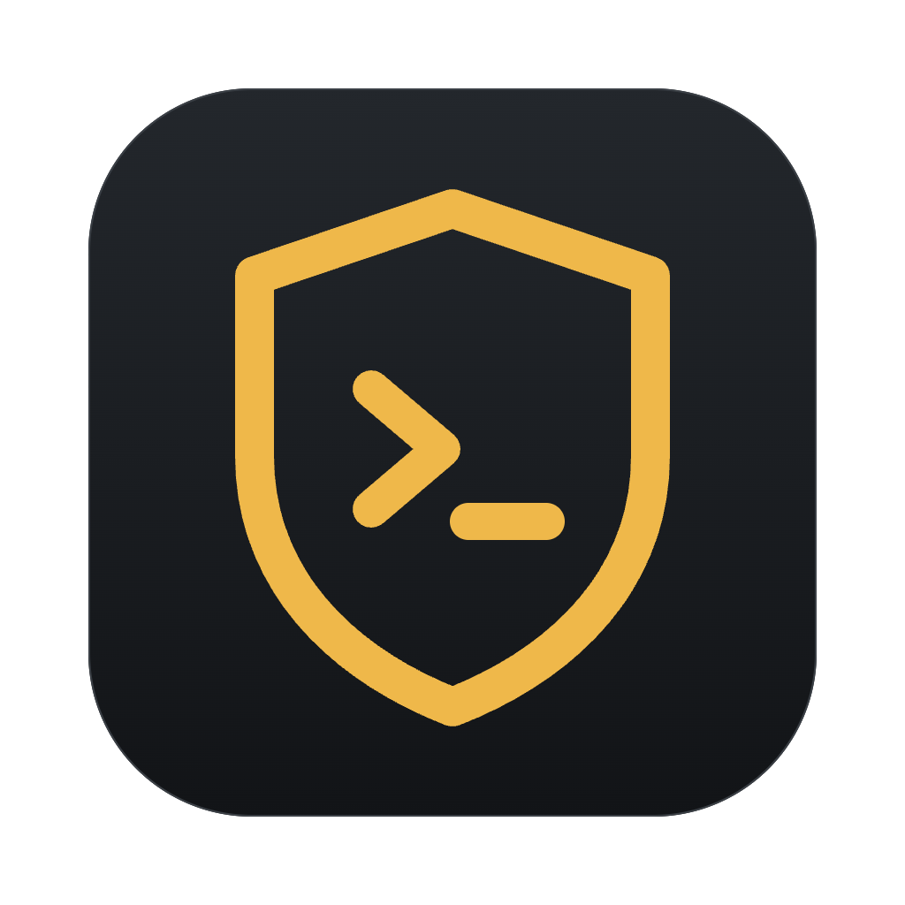

<p align="center">
  
</p>

<h1 align="center">aiegis</h1>

<p align="center">
  Десктопное приложение для AppSec-аудита кода поверх <a href="https://docs.claude.com/en/docs/claude-code/overview">Claude Code</a> или <a href="https://pi.dev">pi</a>
</p>

<p align="center">
  <a href="https://github.com/seelentov/aiegis/releases/latest"></a>
  <a href="LICENSE"></a>
  
</p>


aiegis превращает аудит безопасности репозитория в управляемый процесс: требования из стандартов и внутренних
гайдлайнов раскладываются в матрицу «требование × модуль», а фоновые сессии ИИ-агента выносят по каждой ячейке
вердикт со ссылками на код. Приложение не содержит своего чата — оно запускает локальный кодинг-агент, хранит данные,
промпты и конфигурацию, а агент общается с приложением через встроенный MCP-сервер. По умолчанию это `claude`
(Claude Code); вместо него можно включить [pi](https://pi.dev) — как в [JetBrains ThinkRail](https://github.com/JetBrains/thinkrail) —
и работать с моделями любого провайдера.

> Статус: **0.x, ранняя версия.** Интерфейс на английском и русском (`ui.language`). Основная платформа — macOS; сборки для Windows и Linux
> собираются автоматически, но проверены меньше.

## Возможности

- **Модули** — репозиторий делится на модули (имя + globs), разметку может сделать ИИ; изменения хранят историю.
- **Карта точек входа** — HTTP/gRPC/GraphQL/очереди/cron/CLI/WebSocket/плагины: хэндлер, middleware, авторизация,
  параметры и цепочка вызовов до sink'ов. Версионируется по коммитам.
- **Документы → требования** — загрузка MD/PDF/DOCX, ИИ извлекает пункты с цитатами, обязательное ревью человеком,
  повторный импорт показывает diff и переносит неизменённые пункты.
- **Матрица** — дешёвый отсев `n/a`, затем вердикты `pass | finding | needs_human` с обоснованием и ссылками на код;
  запуск по столбцу, строке, разделу, всегда с dry-run оценкой токенов.
- **Находки** — жизненный цикл `suspected → verified | false_positive | accepted_risk | fixed`, дедупликация
  (`find_similar` перед созданием), связь M:N с ячейками матрицы.
- **Сигналы SAST** — Semgrep, Gitleaks и Trivy запускаются раз на коммит; результаты нормализуются и выдаются агенту
  как подсказки. Подавления с причиной, автором и сроком.
- **SCA** — ИИ-инвентаризация зависимостей модуля, префильтр без ИИ по именам импорта, проверка достижимости
  уязвимости по пакету; достижимая уязвимость порождает находку.
- **PoC-тестировщик** — поднимает тестовый инстанс из worktree и проверяет находку запросами только к `base_url`
  (песочница ОС + хук на сетевые команды). Как поднять проект, может разобраться агент env-setup: он описывает
  тестовое окружение и сам проверяет, что оно стартует.
- **Актуальность** — каждый вердикт привязан к коммиту и файлам-доказательствам; изменения кода помечают его `stale`.
- **Выбор агента** — Claude Code или pi для всего приложения, проекта, роли или модуля (поле каскада `agent`).
- **История** — append-only прогоны: коммит, снимок конфигурации, сессия, токены и стоимость; любую сессию можно
  открыть во встроенном терминале и продолжить интерактивно.

## Как это устроено

- Фоновые прогоны — `claude -p --output-format stream-json` или `pi --mode json` в `git worktree` на зафиксированном
  коммите: рабочее дерево пользователя не трогается.
- Каждый прогон получает свой токен MCP-сервера (у `claude` — `--mcp-config`, у `pi` — через расширение aiegis):
  сервер знает роль и scope, записи вне scope отклоняются.
- Права ролей пишутся один раз в синтаксисе Claude Code; для pi их проверяет расширение aiegis на каждом вызове
  инструмента (у pi своей системы прав нет).
- Ничего не захардкожено: агент, промпты ролей, права, модели, effort, сканеры и лимиты лежат в редактируемых файлах
  с каскадом `глобальный → проект → роль → модуль → матрица → пункт`.
- Данные: `~/.aiegis/` (глобальные настройки), `<repo>/.aiegis/` (настройки проекта, коммитятся),
  каталог данных приложения (`db.sqlite`, документы, worktree).

Подробнее — в [документации](docs/README.md).

## Скриншоты

| | |
|---|---|
|  |  |
|  |  |

Все скриншоты с описанием разделов — в [docs/README.md](docs/README.md).

## Установка

Требования:

- установленный и залогиненный [Claude Code](https://docs.claude.com/en/docs/claude-code/setup) (`claude` в `PATH`) —
  агент по умолчанию; или [pi](https://pi.dev) (`npm install -g @earendil-works/pi-coding-agent`, `pi` в `PATH`,
  провайдер настроен в самом pi) и `agent: pi` в `~/.aiegis/config.yaml`
  (подробнее — [ИИ-агент](docs/README.md#ии-агент-claude-code-или-pi));
- `git`;
- по желанию — `semgrep`, `gitleaks`, `trivy` в `PATH` (без них соответствующие сканеры отключаются).

Готовые сборки — на странице [релизов](https://github.com/seelentov/aiegis/releases/latest):

| Платформа | Файл |
|---|---|
| macOS (Apple Silicon) | `aiegis-<версия>-mac-arm64.dmg` |
| Windows x64 | `aiegis-<версия>-win-x64.exe` |
| Linux x64 | `aiegis-<версия>-linux-x86_64.AppImage`, `.deb` |

Сборки не подписаны. На macOS при первом запуске: правый клик по приложению → «Открыть»
(или `xattr -dr com.apple.quarantine /Applications/aiegis.app`).

### Из исходников

```bash
git clone https://github.com/seelentov/aiegis.git
cd aiegis
npm install        # пересобирает better-sqlite3 и node-pty под Electron
npm start
```

## Разработка

```bash
npm run typecheck  # TypeScript
npm test           # unit-тесты (без вызовов ИИ)
npm run dist       # сборка установщика для текущей ОС в release/
```

Релизные сборки для всех платформ собирает [GitHub Actions](.github/workflows/release.yml) при публикации релиза.

## Лицензия

[MIT](LICENSE). Методические фрагменты в `defaults/instructions/methodology/` адаптированы из
[cloudflare/security-audit-skill](https://github.com/cloudflare/security-audit-skill) (MIT, © Cloudflare, Inc.).
