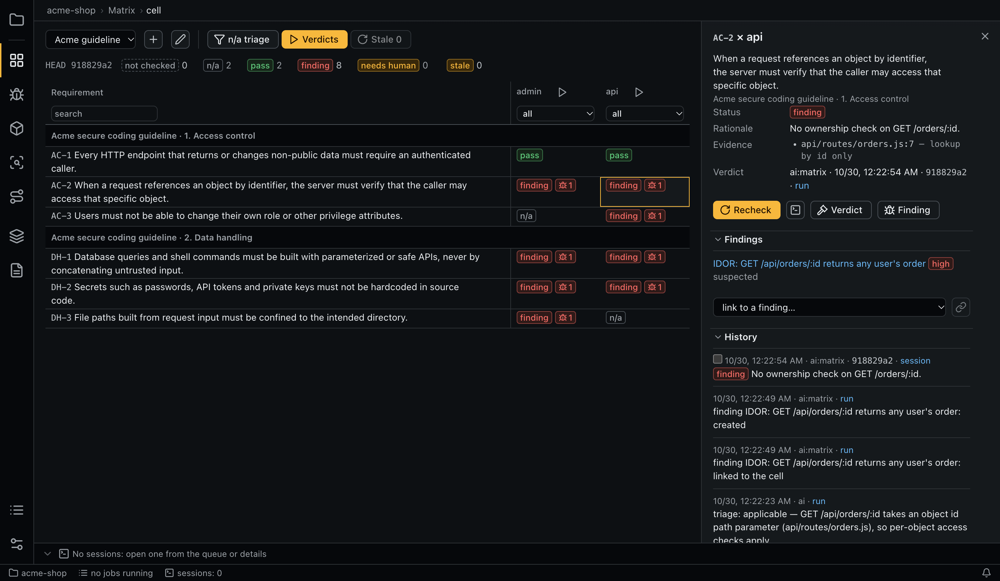
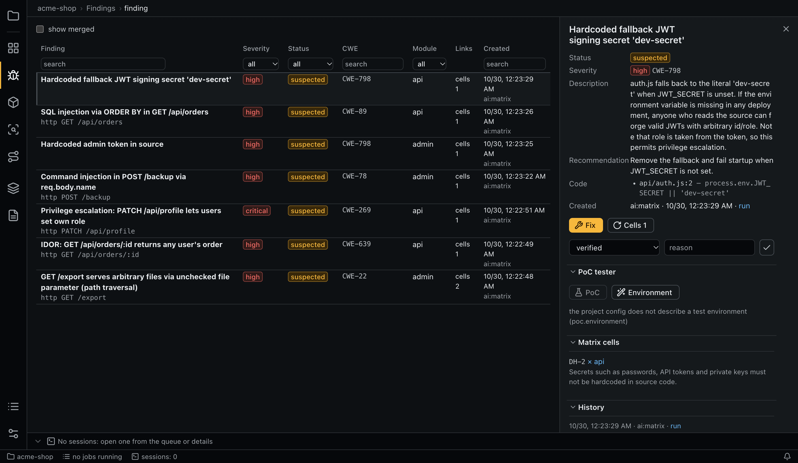
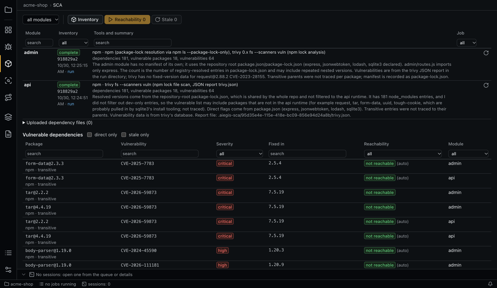
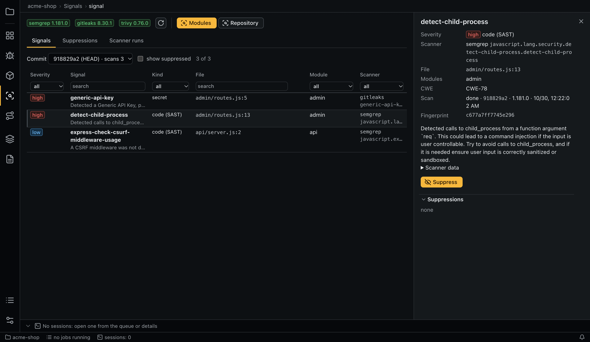
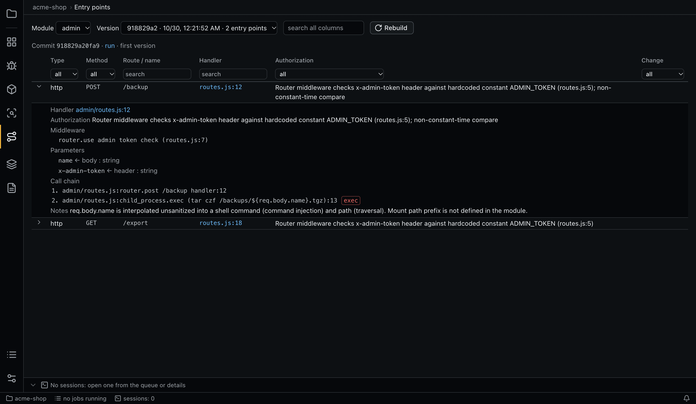
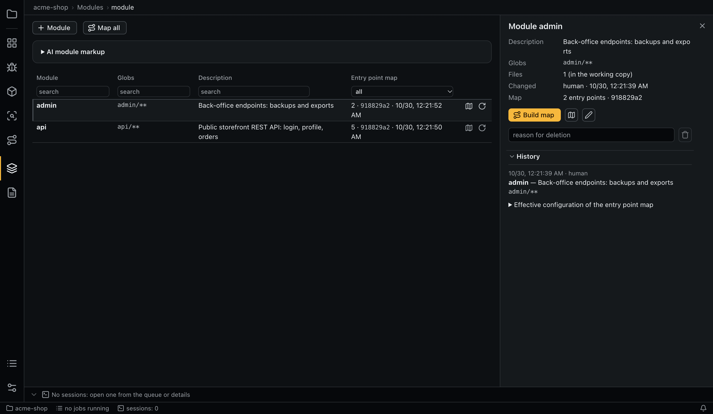
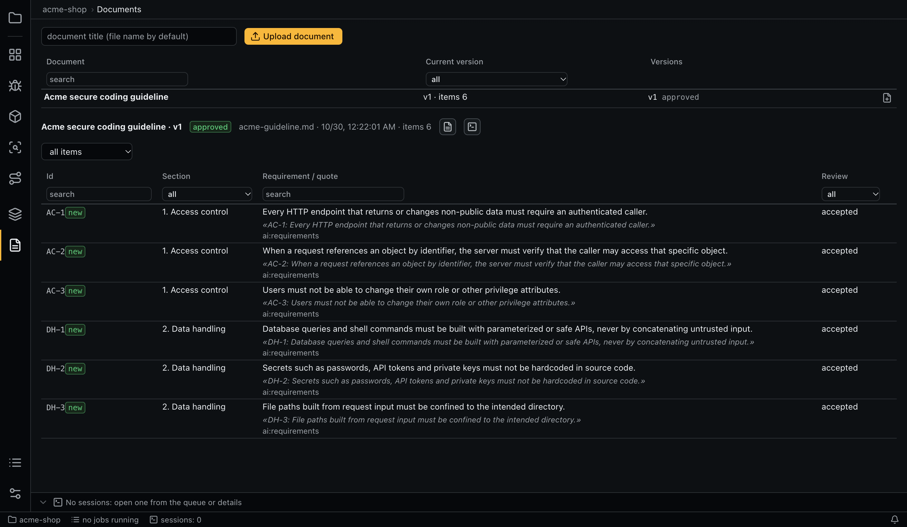
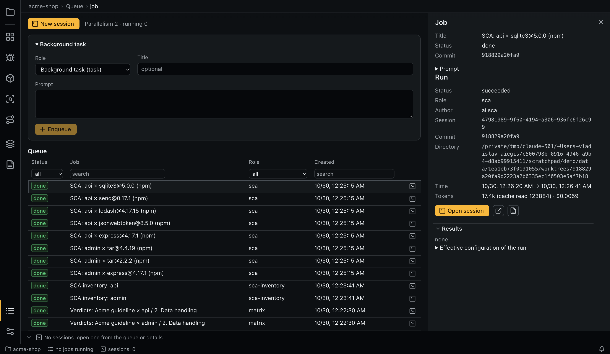
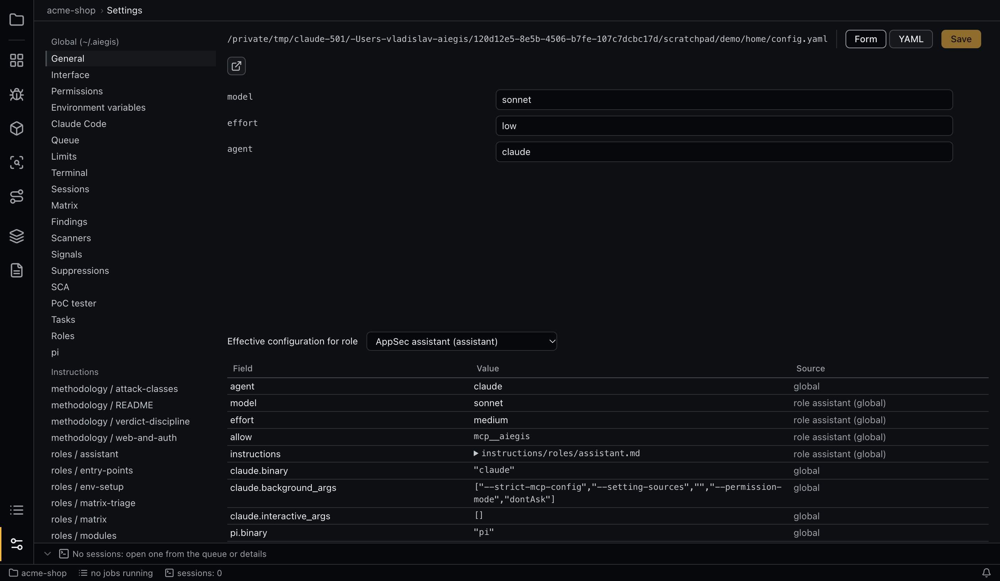

# Документация aiegis

Скриншоты сняты на небольшом демо-API (Node.js/Express с намеренно оставленными уязвимостями): два модуля, гайдлайн из
шести пунктов, дешёвые модели (Haiku для отсева и SCA, Sonnet с низким effort для вердиктов). Все данные на скриншотах —
результат реального прогона.

- [Первый запуск](#первый-запуск)
- [Типовой сценарий аудита](#типовой-сценарий-аудита)
- [Разделы приложения](#разделы-приложения)
- [Конфигурация](#конфигурация)
- [ИИ-агент: Claude Code или pi](#ии-агент-claude-code-или-pi)
- [Где хранятся данные](#где-хранятся-данные)
- [Безопасность прогонов](#безопасность-прогонов)

## Первый запуск

1. Установите и залогиньте [Claude Code](https://docs.claude.com/en/docs/claude-code/setup): команда `claude` должна
   работать в терминале. Вместо него (или вместе с ним) можно использовать [pi](https://pi.dev) с любым провайдером
   моделей — см. [ИИ-агент](#ии-агент-claude-code-или-pi).
2. По желанию установите сканеры: `semgrep`, `gitleaks`, `trivy` (на macOS — `brew install semgrep gitleaks trivy`).
   Приложение проверяет их наличие при старте; недоступный сканер просто пропускается.
3. Запустите aiegis и нажмите **Add project** — выберите корень git-репозитория.

При первом старте в `~/.aiegis/` копируются файлы по умолчанию: `config.yaml` и промпты ролей. Их можно править прямо
во вкладке **Settings**.

Интерфейс по умолчанию английский; русский включается в **Settings → Interface → language: ru** (`ui.language`
в `~/.aiegis/config.yaml`). Ниже названия кнопок даны по английскому интерфейсу. Навигация — панель слева; `⌘1…9`
(`Ctrl+1…9`) переключают разделы, `⌘B` скрывает список проектов, `⌘J` — терминал.

## Типовой сценарий аудита

1. **Модули.** Создайте модули вручную (имя + globs) или запустите **AI module markup**.
2. **Карты точек входа.** **Map all** строит карту по сессии на модуль.
3. **Документ.** Загрузите стандарт или внутренний гайдлайн (MD/PDF/DOCX). ИИ извлечёт пункты с цитатами; просмотрите
   их, примите или отклоните и утвердите версию.
4. **Матрица.** Создайте матрицу из документов и модулей, запустите **n/a triage**, затем **Verdicts**. Перед запуском
   показывается dry-run оценка числа сессий и токенов.
5. **Находки.** Разберите `suspected`-находки: подтвердите, отклоните как false positive, примите риск или откройте
   сессию для фикса. Проверьте находку PoC-тестировщиком: если тестовое окружение ещё не описано, кнопка **Environment**
   запускает агента env-setup, который сам разберётся, как поднять проект.
6. **SCA и сигналы.** Запустите инвентаризацию зависимостей и проверку достижимости; просмотрите сигналы сканеров
   и подавите шум с указанием причины.
7. **Повторный аудит.** После новых коммитов вердикты, чьи файлы-доказательства изменились, помечаются `stale` —
   перепроверьте только их.

## Разделы приложения

### Матрица

Ячейка — требование × модуль. Статусы: `not checked`, `n/a`, `pass`, `finding`, `needs human` и флаг `stale`.
Счётчики над сеткой работают как фильтр, кнопки ▷ в заголовках запускают вердикты по столбцу, строке или разделу.
Справа — обоснование вердикта со ссылками на код, связанные находки, история и действия (перепроверить, открыть
сессию, поставить вердикт вручную).



### Находки

Находка связана с ячейками матрицы (M:N) и точкой входа. Жизненный цикл:
`suspected → verified | false_positive | accepted_risk | fixed`. Перед созданием находки агент обязан вызвать
`find_similar` и при совпадении привязать ячейку к существующей находке; дубликаты можно объединить вручную.
**Fix** открывает интерактивную сессию агента в рабочей директории с контекстом находки.

**PoC** запускает тестировщика: приложение поднимает тестовый инстанс из worktree по `poc.environment`, ждёт
healthcheck, и агент проверяет находку запросами только к `base_url`. Окружение можно описать вручную
(см. [Конфигурация](#конфигурация)) или кнопкой **Environment** поручить агенту env-setup: он изучает проект (код,
документацию, сборочные файлы и локальный checkout пользователя), записывает `poc.environment` в
`<repo>/.aiegis/config.yaml` (вспомогательные скрипты — в `<repo>/.aiegis/poc/`) и сам запускает окружение, пока
healthcheck не пройдёт. Вывод неудавшегося запуска передаётся следующей сессии env-setup. Окружение одно на проект,
поэтому тестировщик и env-setup выполняются по одному.



### SCA

ИИ-инвентаризация модуля сама выбирает инструмент (npm, Gradle, trivy и т. д.), учитывает загруженные lock-файлы,
SBOM и отчёты; каждая уязвимость обязана быть в сохранённом отчёте инструмента. Префильтр без ИИ закрывает пакеты,
которые файлы модуля не импортируют (`not reachable (auto)`). Остальные проверяются сессией на модуль × пакет:
`reachable | not_reachable | needs_human` с доказательствами. Достижимая уязвимость порождает находку.



### Сигналы

Semgrep, Gitleaks и Trivy запускаются приложением раз на коммит в worktree, вывод нормализуется. Агент получает
срез сигналов по модулю и требованию через MCP — как подсказки, а не полный список. Подавления: на сигнал, на правило
в glob или на пункт × модуль; причина обязательна, срок — опционально. Релевантные подавления подмешиваются
в промпт вердиктов как примеры.



### Точки входа

Карта модуля: тип, метод, маршрут, хэндлер `файл:строка`, middleware, требования авторизации, параметры с источником
и цепочка вызовов до sink'ов. Каждая карта — снимок на коммите; версии можно сравнивать.



### Модули

Модуль — имя, globs (источник истины) и описание. Правки сохраняют историю; у модуля видна итоговая конфигурация
с источником каждого значения.



### Документы

Версии документа и извлечённые требования: id из документа, раздел, текст и дословная цитата. Без ревью версию нельзя
утвердить. Повторный импорт показывает diff: изменённые пункты становятся `stale`, неизменённые переносятся.



### Очередь

Единая очередь фоновых задач с настраиваемой параллельностью. У каждого прогона — коммит, сессия, каталог worktree,
токены и стоимость. **Open session** продолжает её во встроенном терминале (`claude --resume` или `pi --session-id`); пока фоновый
процесс жив, поток показывается read-only, кнопка перехвата (**Take over into an interactive session**) останавливает его и открывает интерактивную сессию. При rate limit
подписки очередь встаёт на паузу до сброса.



### Настройки

Глобальный и проектный `config.yaml` редактируются формой: разделы конфига слева, поля справа; у проектного конфига
видны значения, унаследованные от глобального. Переключатель **YAML** открывает файл целиком, промпты ролей и задач
редактируются как текст. Таблица **Effective configuration for role** показывает значение каждого поля (агент, модель,
effort, права, …) для выбранной роли и уровень, с которого оно пришло.



## Конфигурация

Ничего не захардкожено: агент, модели, effort, промпты ролей, права инструментов, сканеры, лимиты и параллельность лежат
в файлах.

| Где | Что |
|---|---|
| `~/.aiegis/config.yaml` | глобальные настройки (копируются из `defaults/` при первом старте) |
| `~/.aiegis/instructions/**` | промпты ролей, задач и методики |
| `<repo>/.aiegis/config.yaml` | настройки проекта — коммитятся и ревьюятся вместе с кодом |

Каскад: `глобальный → проект → роль → модуль → матрица/стандарт → пункт`. Поля уровня: `agent`, `model`, `effort`,
`instructions`, `permissions`, `env`.

- `agent`, `model`, `effort` — нижний уровень заменяет верхний;
- `instructions` — склеиваются сверху вниз, `mode: replace` заменяет всё выше;
- `permissions.allow/deny` — объединяются, `deny` побеждает;
- `env` — сливаются, нижний уровень побеждает по ключу.

Пример проектного конфига — дешёвые модели и тестовое окружение для PoC-тестировщика:

```yaml
roles:
  matrix-triage: { model: haiku, effort: low }
  matrix: { model: sonnet, effort: low }
limits:
  max_tokens_per_run: 150000
poc:
  environment:
    start: npm start
    healthcheck: curl -sf http://127.0.0.1:3000/health
    base_url: http://127.0.0.1:3000
    accounts:
      alice: { username: alice, role: customer, secrets: { password: { env: POC_ALICE_PASSWORD } } }
```

Полный список ключей с комментариями — в [`defaults/config.yaml`](../defaults/config.yaml).

## ИИ-агент: Claude Code или pi

Сессии запускает кодинг-агент, выбранный полем каскада `agent`:

- `claude` (по умолчанию) — локальный [Claude Code](https://docs.claude.com/en/docs/claude-code/overview) по подписке
  или API-ключу. Настройки запуска — секция `claude:`.
- `pi` — [pi coding agent](https://pi.dev) (тот же движок, что у [JetBrains ThinkRail](https://github.com/JetBrains/thinkrail)):
  модели любого провайдера, которого знает pi (Anthropic, OpenAI, Google, локальные через `models.json` и т. д.),
  учётные данные — собственные pi (`pi` → `/login` или переменные окружения провайдера). Настройки запуска — секция `pi:`.

Поле работает на любом уровне каскада, поэтому агента можно сменить для всего приложения, проекта, роли или модуля:

```yaml
# ~/.aiegis/config.yaml — всё через pi
agent: pi

# <repo>/.aiegis/config.yaml — только дешёвые этапы через pi и модель OpenAI
# (id модели — из `pi --list-models`; pi показывает модели провайдеров, для которых есть учётные данные)
roles:
  matrix-triage: { agent: pi, model: openai/gpt-5-mini, effort: low }
  sca: { agent: pi, model: openai/gpt-5-mini }
```

Как aiegis запускает pi:

| | Claude Code | pi |
|---|---|---|
| фоновый прогон | `claude -p --output-format stream-json --session-id …` | `pi --mode json --session-id …` |
| продолжение сессии | `claude --resume <id>` | `pi --session-id <id>` |
| модель / effort | `--model` / `--effort` | `--model` / `--thinking` |
| инструкции роли | `--append-system-prompt` | `--append-system-prompt` |
| MCP aiegis | `--mcp-config` (файл с токеном) | расширение aiegis регистрирует сервер с токеном прогона |
| права `permissions` | `--allowedTools` / `--disallowedTools` | расширение aiegis проверяет каждый вызов инструмента |
| изоляция фона | `claude.background_args` | `pi.background_args`: без пользовательских расширений, скиллов, шаблонов и проектных настроек |
| песочница PoC-тестировщика | `poc.claude_settings` → `--settings` | `poc.pi_sandbox` → расширение aiegis (`@anthropic-ai/sandbox-runtime`) |

У pi нет собственной системы прав, поэтому вместе с каждой сессией загружается расширение aiegis
(`dist/pi-extension.mjs`, поставляется с приложением). Оно читает правила роли в синтаксисе Claude Code и:

- сопоставляет инструменты через `pi.tools` (`Read → read`, `Grep → grep`, `Glob → find, ls`, `Bash → bash`,
  `Edit → edit`, `Write → write`; у `WebFetch`, `NotebookEdit` аналога нет);
- `deny` побеждает, в том числе для любой части составной команды;
- `Bash(git log:*)` разрешает команду с этим префиксом; с правилами-шаблонами разрешена только простая команда —
  без подстановок `$(…)`, обратных кавычек и перенаправлений, а каждая часть `&&`/`;`/`|` (вне кавычек) должна быть
  разрешена;
- `Edit(./.aiegis-sca/**)` и подобные — запись только по шаблону пути; инструменты чтения не выходят за рабочий каталог
  и `permissions.dirs`;
- не разрешённое правилами в фоне блокируется, в интерактивной сессии — спрашивается у пользователя.

PoC-тестировщик с pi изолирован так же, как с Claude Code, и той же библиотекой — `@anthropic-ai/sandbox-runtime`,
на которой построена песочница Claude Code (macOS Seatbelt, Linux bubblewrap):

- каждая bash-команда тестировщика сначала проходит тот же хук aiegis (запросы только к origin `base_url`, без
  перенаправления через прокси), затем выполняется в песочнице ОС: сеть — только `host:port` из `base_url`, запись —
  только в рабочий каталог;
- инстанс на localhost доступен через прокси песочницы, поэтому открыт ровно его порт; другие порты localhost
  (в том числе сервер aiegis) и интернет закрыты. Claude Code для localhost требует `allowLocalBinding`, который
  открывает скриптам все локальные порты;
- если песочница недоступна (Windows, нет bubblewrap на Linux) или хук не отвечает, команды блокируются;
- настройка — `poc.pi_sandbox` (формат конфигурации sandbox-runtime), хост `base_url` приложение добавляет само.

Ограничения pi:

- Rate limit провайдера распознаётся по тексту ошибки; время сброса неизвестно, поэтому очередь встаёт на паузу
  на `queue.rate_limit_fallback_pause_sec`.
- Сессия продолжается только тем агентом, который её создал: если после прогона сменить `agent`, «Открыть сессию»
  сообщит об этом.
- MCP-серверы из пользовательского `~/.pi/agent/mcp.json` подключаются, но модели в фоне объявляются только инструменты
  `mcp__aiegis__*`.

## Где хранятся данные

| Путь | Содержимое |
|---|---|
| `~/.aiegis/` | глобальная конфигурация и промпты |
| `<repo>/.aiegis/` | конфигурация проекта |
| macOS: `~/Library/Application Support/aiegis/<project-id>/`<br>Windows: `%APPDATA%\aiegis\<project-id>\`<br>Linux: `~/.local/share/aiegis/<project-id>/` | `db.sqlite`, загруженные документы, отчёты сканеров, логи прогонов, git worktree |

Переменные `AIEGIS_HOME` и `AIEGIS_DATA` переопределяют первый и последний каталоги.

## Безопасность прогонов

- Фоновые прогоны идут в отдельном `git worktree` на зафиксированном коммите; рабочее дерево пользователя не меняется.
- Каждая сессия получает собственный токен MCP-сервера (`127.0.0.1`, случайный порт): по токену сервер знает роль
  и scope, записи вне scope отклоняются.
- Права инструментов задаются в конфиге (у Claude Code — `--allowedTools` / `--disallowedTools`, у pi их проверяет
  расширение aiegis); фоновые роли по умолчанию только читают код.
- PoC-тестировщик работает в песочнице ОС (у Claude Code — встроенной, у pi — через расширение aiegis): сеть ограничена
  хостом `base_url`, дополнительный хук отклоняет команды к другим хостам; секреты тестовых учёток берутся из окружения или связки ключей macOS и не пишутся в файлы.
