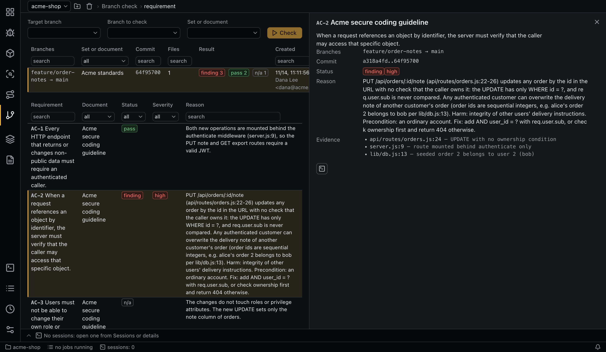

# Branch checks

A branch check reviews a pull request before it merges: do the branch's changes break the requirements of a document set or a document, or add a vulnerability those requirements cover?



## Running a check

1. Choose the **Target branch** (for example `main`) and the **Branch to check**.
2. Choose a **Set or document**.
3. Click **Check** to see the estimate, then run it.

The diff runs from the fork point (`git merge-base`) to the branch, exactly what a pull request shows, so later commits on the target are left out. A branch with no changes is refused.

Branches come from local and remote-tracking refs. **The app does not run `git fetch`**, so fetch first if you need the latest.

## What is checked

The accepted items of the current approved versions of the target. Documents [out of force](documents.md#out-of-force) are left out. A check stores the target's name and versions at the start, so later edits to a set do not change the result.

## Sessions

Usually one session covers the whole check (task `diff_check`, role `diff-check`), running in a worktree at the branch's commit. All the items and the diff go into the prompt, up to `diff_check.max_diff_kb_in_prompt` (1000 KB, about 450 thousand tokens). Above that the diff stays out and the agent reads what it needs with `git diff`, which misses more: on a 289 KB branch an agent reading the diff by itself found 1 of 5 planted flaws, and the diff in the prompt found all 5.

Files matching `diff_check.prompt_exclude` (tests, styles, lock and generated files by default) are left out of the diff in the prompt. They stay in the list of changed files, and the agent reads them when they matter.

The agent first lists the security-relevant changes, then reads the code each of them affects outside the diff: callers of a changed method, a called method, how a new operation is exposed. A candidate it could not trace to the end becomes `needs_human`.

Sessions are split only above `diff_check.batch_size` items, because each session would read the same diff again. Splitting a large diff by files was measured too: it cost about 40% more and found no more.

A global config from an older version keeps its own `max_diff_kb_in_prompt` (200 before): raise it by hand.

Runs are atomic per item: **Retry** takes only items with no verdict.

## Verdicts

The same statuses as the matrix:

| Status | Needs |
|---|---|
| `n/a` | A reason |
| `pass` | A reason and code references |
| `finding` | A reason, code references, a severity, and a reference to at least one **changed file**, because what is not in the diff was not caused by the branch. A file the branch deleted counts |
| `needs_human` | A reason and code references |

The agent records verdicts in groups with `set_diff_verdicts`. Invalid entries come back to it as `rejected`, and the rest are saved.

## Separate from the audit

The code has not merged, so results stay inside the check and do not reach **Findings** or the matrix. A new check is a new record, and the history stays. There are no manual verdicts in a check.

## The tab

- **Target branch**, **Branch to check**, **Set or document** and **Check**: pick and run.
- The list of checks: branches, set or document, commit, number of changed files, results and who created it, with a counter of sessions running. Select a check to see its requirements.
- The requirements of a check: requirement, document, status, severity and reason. Select one for the details: branches, commit range, evidence and the verdict session.

## Estimate

The estimate uses the matrix's panel, with requirements instead of cells, without run history. Each session counts items × `diff_check.estimate_tokens_per_requirement` plus the KB of the diff in its prompt × `diff_check.estimate_tokens_per_diff_kb`.

## On a schedule

The `diff_check` schedule action runs a check on cron. When the same fork point, commit and document versions were already checked, the firing is `nothing_to_do` and spends no tokens. A manual run from the tab always checks again. See [Schedules](schedules.md).

## Safety

The diff is untrusted, and the role's prompt treats it as data, not instructions. The role cannot write, and `--output` of `git log`, `git show` and `git diff` is denied, including abbreviations, since it would let those commands write files. See [Security](security.md).

## Command line

```bash
aiegis diff branches
aiegis diff estimate --base main --head task-123 --set <id>
aiegis diff run --base main --head task-123 --set <id>     # or --document <id>
aiegis diff list
aiegis diff show <check>
```

`diff run` shows the estimate and asks for confirmation; `--yes` skips this.
