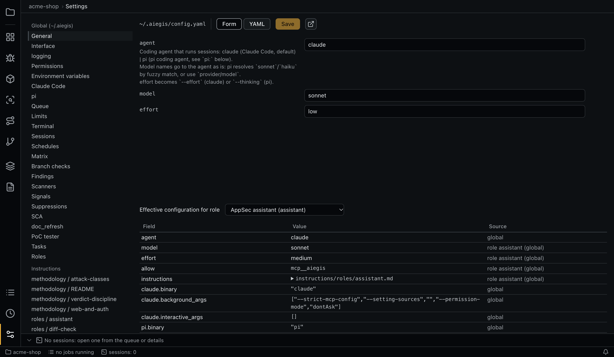
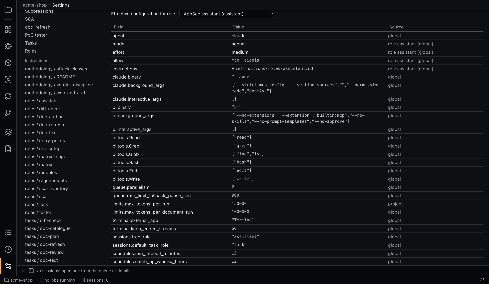

# Configuration

Nothing is hardcoded. The agent, models, effort, role prompts, tool permissions, scanners, limits and parallelism are all in editable files, and settings are not kept in the database.

| Location | What | Notes |
|---|---|---|
| `~/.aiegis/config.yaml` | Global settings | Copied from the defaults on first start |
| `~/.aiegis/instructions/**` | Prompts of roles and tasks, methodology | Same |
| `<repo>/.aiegis/config.yaml` | Project settings | Commit and review them with the code |
| `<repo>/.aiegis/instructions/**` | Project prompts | Same |

`AIEGIS_HOME` replaces `~/.aiegis`. The full list of keys with comments is in [`defaults/config.yaml`](../defaults/config.yaml).

## The cascade

```text
global → project → role → module → matrix/standard → item
```

| Level | Where |
|---|---|
| Global | Top level of `~/.aiegis/config.yaml` |
| Project | Top level of `<repo>/.aiegis/config.yaml` |
| Role | `roles.<name>`, global then project |
| Module | `modules.<name>`, project config, matched by module name |
| Matrix or standard | `matrices.<name>`, project config |
| Item | `requirements.<key>`, project config. If documents share a key, they share the level |

Each level may set these fields:

| Field | How levels combine |
|---|---|
| `agent`, `model`, `effort` | The lower level replaces |
| `instructions` | Concatenated top-down. `mode: replace` drops everything above |
| `permissions.allow`, `permissions.deny`, `permissions.dirs` | Union. `deny` wins |
| `env` | Merged. The lower level wins per key |

`instructions` is a string or `{ mode: append | replace, text, file }`, and `file` is a path or a list of paths, relative to the directory of the config file that names it. `permissions.dirs` lists directories outside the working directory the agent may use (`~/` is your home; passed as `claude --add-dir`).

```yaml
# <repo>/.aiegis/config.yaml
model: sonnet
roles:
  matrix-triage: { model: haiku, effort: low }
  matrix:
    instructions:
      file: instructions/our-matrix-rules.md
modules:
  payments:
    effort: high
    # A copy of the methodology that is off by default, for modules with HTTP and authentication.
    instructions:
      file: instructions/web-and-auth.md
matrices:
  PCI:
    instructions: "Cite the PCI clause in every verdict."
requirements:
  AC-2:
    effort: high
```

All other sections are not part of the cascade: they merge per key from global to project. A required key with no value is a configuration error, because the code has no built-in values. An invalid global config is reported, and the last valid settings stay in use.

## The Settings tab



Settings edits the same files. On the left are the sections of `config.yaml` (General, then one per map) for the global and project configs, and below them the instruction files by name.

- **Form** builds fields from the YAML: the type comes from the value (checkbox, number, text, one value per line in a list), and the hint comes from the comment above the key. Comments survive editing.
- In a project config, global values show as inherited. Clearing a field or **Restore the global value** removes the key.
- **YAML** edits the file as text, for new keys and complex values.
- Leaving the tab with unsaved changes asks for a confirmation.
- **Open the file in an external editor** opens it in VS Code.

### Effective configuration



**Effective configuration for role** lists the final value of each field and the level it came from. Cells, modules, SCA items and runs show the same thing in their details; a run keeps a snapshot from when it ran. From the command line: `aiegis config effective <role> [--module <name>] [--matrix <name>] [--item <key>]`.

## Upgrades

On every start:

- missing top-level keys and missing entries of `roles`, `tasks`, `scanners`, `poc`, `terminal`, `limits`, `doc_refresh`, `matrix`, `findings` and `diff_check` are added to your global `config.yaml`. Existing values and comments are not changed, so the **values** of a role you already have, such as its permissions, are not updated;
- `~/.aiegis/.defaults.json` holds the hash of each default file. A default file that changed replaces yours if you did not edit it, with a notification. If you edited it, your file stays, and one warning lists what to merge by hand.

## Settings reference

### General

| Key | Default | Meaning |
|---|---|---|
| `ui.language` | `en` | `en` or `ru`. Global only. Also picks the `{ en, ru }` variant of titles |
| `ui.page_size` | `50` | Rows per page of a table, and of `aiegis job page` and `run page`. Global only |
| `ui.history_page_size` | `20` | Entries per page of a history in the details panel. Global only |
| `agent` | `claude` | `claude` or `pi`. See [Agents](agents.md) |
| `model` | `sonnet` | Passed to the agent as is |
| `effort` | `low` | `--effort` (claude) or `--thinking` (pi) |
| `permissions` | empty | `allow`, `deny` |
| `env` | empty | Variables for agent sessions |

### `logging`

Global only. See [Data and logs](data-and-logs.md#logs).

| Key | Default | Meaning |
|---|---|---|
| `logging.level` | `info` | `error`, `warn`, `info`, `debug`, `trace` |
| `logging.categories` | empty | Levels per category: `core`, `queue`, `agent`, `scanners`, `mcp`, `git`, `poc` |
| `logging.stderr` | `true` | Write to stderr |
| `logging.file.enabled` | `true` | Write to the log file |
| `logging.file.max_size_mb` | `10` | Rotate at this size |
| `logging.file.backups` | `5` | Rotated files to keep |

### `claude`, `pi`

| Key | Meaning |
|---|---|
| `claude.binary` | The executable. Use a full path if it is not found |
| `claude.background_args` | Extra arguments of background runs. The default isolates them from your hooks and plugins: `--strict-mcp-config --setting-sources "" --permission-mode dontAsk` |
| `claude.interactive_args` | Extra arguments of interactive sessions |
| `pi.binary` | The executable |
| `pi.background_args` | The default is `--no-extensions --extension builtin:mcp --no-skills --no-prompt-templates --no-approve`. Keep `builtin:mcp`, or the MCP server will not connect |
| `pi.interactive_args` | Extra arguments of interactive sessions |
| `pi.tools` | Maps Claude Code tool names in `permissions` to pi tools |

### `queue`, `limits`, `terminal`, `sessions`

| Key | Default | Meaning |
|---|---|---|
| `queue.parallelism` | `2` | Jobs at once. Global only |
| `queue.rate_limit_fallback_pause_sec` | `900` | Pause when the reset time is unknown. Global only |
| `queue.pause_after_refusals` | `3` | Runs the model declined in a row before the queue pauses; `0` never pauses. Global only |
| `queue.refusal_pause_sec` | `3600` | How long that pause lasts; **Continue** resumes earlier. Global only |
| `limits.max_tokens_per_run` | `300000` | Stops a run above this |
| `limits.max_tokens_per_document_run` | `1000000` | The same for reading documents, extraction and document checks |
| `limits.entry_points_inline_chars` | `60000` | A larger entry point map reaches agents as a brief list, with details on request |
| `terminal.external_app` | `Terminal` | macOS application for an external terminal |
| `terminal.keep_ended_streams` | `50` | Ended output streams kept in memory |
| `sessions.free_role` | `assistant` | Role of **New session** and fix sessions |
| `sessions.default_task_role` | `task` | Role preselected for background tasks |

### `schedules`

| Key | Default | Meaning |
|---|---|---|
| `schedules.min_interval_minutes` | `15` | A more frequent expression is refused |
| `schedules.catch_up_window_hours` | `12` | A later firing is only recorded as missed |
| `schedules.max_tokens_per_firing` | `1000000` | Above this estimate a firing does not start |

### `matrix`, `diff_check`, `findings`, `hunt`

| Key | Default | Meaning |
|---|---|---|
| `matrix.batch_size` | `6` | Cells per verdict session |
| `matrix.triage_batch_size` | `40` | Cells per triage session |
| `matrix.estimate_history_runs` | `20` | Runs averaged for an estimate |
| `matrix.estimate_tokens_per_cell.triage` | `4500` | Estimate with no history |
| `matrix.estimate_tokens_per_cell.verdicts` | `17000` | Estimate with no history |
| `matrix.economy_above_tokens` | `1000000` | Above this usual estimate verdicts go as [merged sessions](matrix.md#merged-sessions-for-large-runs); `0` turns them off |
| `matrix.economy_batch_size` | `100` | Cells per merged session |
| `matrix.estimate_tokens_per_economy_session` | `165000` | Estimate of a merged session with no history |
| `diff_check.batch_size` | `600` | Requirements per session |
| `diff_check.max_diff_kb_in_prompt` | `1000` | A larger diff stays out of the prompt |
| `diff_check.prompt_exclude` | tests, styles, lock and generated files | Pathspec globs left out of the diff in the prompt |
| `diff_check.estimate_tokens_per_requirement` | `250` | Estimate per requirement |
| `diff_check.estimate_tokens_per_diff_kb` | `450` | Estimate per KB of the diff in a session's prompt |
| `findings.similar_limit` | `5` | Candidates from `find_similar` |
| `findings.verify_estimate_history_runs` | `20` | Recent runs of `finding-verify` averaged for its estimate |
| `findings.verify_estimate_tokens` | `20000` | Billable tokens per finding in that estimate when there is no history |
| `hunt.batch_files` | `30` | Module files per [hunt](modules.md#vulnerability-hunt) session |
| `hunt.exclude` | tests, vendored, generated code, docs | Pathspec globs of module files the hunt skips |
| `hunt.estimate_history_runs` | `20` | Recent runs of `hunt` averaged for its estimate (tokens per read file) |
| `hunt.estimate_tokens_per_file` | `6000` | Billable tokens per file in that estimate when there is no history |

### `scanners`

`scanners.<name>` has:

| Key | Meaning |
|---|---|
| `enabled` | Turn it on or off |
| `binary` | The executable, from `PATH` |
| `format` | Output normalizer: `semgrep`, `gitleaks`, `trivy` or `sarif` |
| `version_args` | Availability check at startup |
| `args` | Command line. Placeholders are whole arguments only: `{{targets}}` (all paths in one call) or `{{target}}` (one call per path), exactly one of them; `{{report}}` is a report file, otherwise stdout is parsed |
| `ok_exit_codes` | Exit codes meaning the scan completed |
| `timeout_sec` | One invocation is killed after this |

Paths are relative to the worktree root, so rule files committed under `.aiegis/...` work with `--config`:

```yaml
scanners:
  semgrep:
    args: ["scan", "--config", "p/default", "--config", ".aiegis/semgrep/", "--json", "--quiet", "--metrics", "off", "--disable-version-check", "{{targets}}"]
```

### `sarif`

Limits for [imported reports](signals.md#importing-sarif) and scanners with `format: sarif`.

| Key | Default | Meaning |
|---|---|---|
| `sarif.max_file_mb` | `100` | A larger file is rejected before it is read (imports only) |
| `sarif.max_results` | `50000` | A report with more results is rejected |
| `sarif.max_text_chars` | `4000` | Each text of a report is cut to this length |
| `sarif.max_code_flows` | `3` | Code flows kept per result |
| `sarif.max_flow_steps` | `50` | Steps kept per flow |

### `signals`, `suppressions`

| Key | Default | Meaning |
|---|---|---|
| `signals.auto_scan` | `true` | Queue missing scans before verdict sessions |
| `signals.max_per_call` | `40` | Signals per `get_signals` call |
| `signals.exclude_kinds` | `[vuln]` | Kinds `get_signals` does not return |
| `signals.requirements` | empty | [Relevance per requirement key](signals.md#how-agents-read-signals) |
| `suppressions.few_shot_limit` | `5` | Suppressions mixed into verdict prompts |
| `suppressions.apply_stale` | `false` | Whether stale suppressions still filter |

### `sca`

| Key | Default | Meaning |
|---|---|---|
| `sca.estimate_history_runs` | `20` | Runs averaged for an estimate |
| `sca.estimate_tokens_per_package` | `25000` | Estimate with no history |
| `sca.scanner_hints_limit` | `60` | Scanner CVEs listed in the inventory prompt |
| `sca.prefilter_max_file_kb` | `1024` | Larger files are not searched for imports |
| `sca.report_max_mb` | `50` | Larger tool reports are refused |

### `doc_refresh`

| Key | Default | Meaning |
|---|---|---|
| `doc_refresh.max_bytes` | `52428800` | Largest response |
| `doc_refresh.timeout_sec` | `45` | One `fetch_url` call with its redirects |
| `doc_refresh.max_redirects` | `8` | |
| `doc_refresh.user_agent` | `Mozilla/5.0 (compatible; aiegis document refresher)` | |
| `doc_refresh.allow_private_addresses` | `false` | Allow sources on private networks |
| `doc_refresh.page_preview_chars` | `4000` | Page text in the `fetch_url` reply |
| `doc_refresh.max_links` | `150` | Links in the `fetch_url` reply |
| `doc_refresh.js_page_min_chars` | `200` | Less text is reported as possibly needing JavaScript |
| `doc_refresh.restored_min_coverage` | `0.9` | Minimum share of paragraphs found on the page for a text restored by AI |
| `doc_refresh.same_text_max_removed_lines` | `1` | An update adding nothing and removing this many lines is not a change |
| `doc_refresh.update_min_length_ratio` | `0.5` | A shorter new edition is refused |
| `doc_refresh.crop_min_ratio` | `0.5` | A cut keeping less of the page is refused |
| `doc_refresh.volatile_lines` | view counters | Regular expressions for lines left out of comparison |
| `doc_refresh.catalogue_batch` | `25` | Catalogue entries per run |
| `doc_refresh.repeat_min_similarity` | `0.6` | Shared words for a probable repeat |
| `doc_refresh.estimate_history_runs` | `5` | Runs averaged for an estimate |
| `doc_refresh.estimate_tokens` | `60000` | Estimate with no history |

### `poc`

See [PoC tester](poc.md).

| Key | Default | Meaning |
|---|---|---|
| `poc.start_timeout_sec` | `600` | Waiting for the healthcheck |
| `poc.healthcheck_interval_sec` | `5` | |
| `poc.stop_timeout_sec` | `120` | |
| `poc.check_wait_max_sec` | `50` | One polling call of `check_poc_environment` |
| `poc.env_passthrough` | `PATH, HOME, USER, LOGNAME, SHELL, LANG, LC_ALL, TMPDIR` | Variables of the app's environment the tester and instance inherit |
| `poc.claude_settings` | sandbox on | Claude Code settings of tester sessions |
| `poc.pi_sandbox` | empty lists, `strictAllowlist` | `network` and `filesystem` of the OS sandbox under pi |
| `poc.environment` | not set | `start`, `healthcheck`, `stop`, `base_url`, `accounts`; project config |

## Tasks

`tasks.<kind>` has a `role`, a `title` (a string or `{ en, ru }`) and a `prompt`, a template file relative to the config that names it. `{{placeholders}}` are filled by the app, and an unknown placeholder is a configuration error.

| Kind | Role | Placeholders |
|---|---|---|
| `modules` | `modules` | `project`, `hint`, `modules` |
| `entry_points` | `entry-points` | `project`, `module_id`, `module_name`, `module_globs`, `module_description` |
| `requirements` | `requirements` | `project`, `document_title`, `version_id`, `version_n`, `file`, `format`, `previous`, `carried` |
| `doc_refresh` | `doc-refresh` | `project`, `target`, `set_name`, `scope`, `links`, `documents`, `retired` |
| `doc_review` | `doc-refresh` | As `doc_refresh` |
| `doc_catalogue` | `doc-refresh` | As `doc_refresh`, and `entries`, `proposed` |
| `doc_text` | `doc-text` | `project`, `document_title`, `file` |
| `doc_plan` | `doc-author` | `project`, `hint`, `modules`, `generated`, `uploaded` |
| `doc_write` | `doc-author` | `project`, `title`, `slug`, `key_prefix`, `scope`, `modules`, `sections`, `other_documents`, `previous`, `hint` |
| `matrix_triage` | `matrix-triage` | `project`, `matrix`, `module_id`, `module_name`, `module_globs`, `module_description`, `requirements` |
| `matrix_verdicts` | `matrix` | As `matrix_triage`, and `group`, `suppressions` |
| `matrix_economy` | `matrix-economy` | `project`, `matrix`, `modules`, `requirements`, `suppressions`, `cells` |
| `diff_check` | `diff-check` | `project`, `target`, `check_id`, `base_ref`, `head_ref`, `base_sha`, `head_sha`, `changed_files`, `diff`, `requirements` |
| `sca_inventory` | `sca-inventory` | `project`, `module_id`, `module_name`, `module_globs`, `module_description`, `out_dir`, `inputs`, `scanner_hints` |
| `sca_reachability` | `sca` | `project`, `module_id`, `module_name`, `module_globs`, `module_description`, `package_key`, `package`, `direct`, `manifest`, `import_names`, `import_hits`, `vulnerabilities` |
| `finding_verify` | `finding-verify` | `project`, `finding_id`, `title`, `commit_sha`, `claim` |
| `fix_verify` | `finding-verify` | `project`, `finding_id`, `title`, `commit_sha`, `base_commit`, `changed_files`, `claim` |
| `hunt` | `hunt` | `project`, `module_id`, `module_name`, `module_description`, `module_globs`, `files`, `file_count` |
| `poc` | `tester` | `project`, `finding_id`, `title`, `severity`, `cwe`, `description`, `files`, `recommendation`, `entry_point`, `module_name`, `base_url`, `accounts`, `out_dir` |
| `poc_setup` | `env-setup` | `project`, `project_root`, `environment`, `accounts`, `scripts_dir`, `env_passthrough`, `last_failure` |
| `fix` | `assistant` | `project`, `finding_id`, `title`, `severity`, `cwe`, `description`, `files`, `recommendation`, `cells` |

## Roles

`roles.<name>` has the cascade fields plus `title` (a string or `{ en, ru }`), `kind` (`interactive` or `background`) and `mcp_access` (`manage` or `scoped`). Add your own for background tasks.

| Role | Model, effort | Default tools beyond `Read`, `Grep`, `Glob` and MCP |
|---|---|---|
| `assistant` (interactive, `manage`) | sonnet, medium | Asks you, like a normal session |
| `task` | haiku, low | `git log/show/diff` |
| `requirements` | haiku, low | None; no shell |
| `doc-refresh` | sonnet, low | None; reads only its own directory, downloads through `fetch_url` |
| `doc-text` | sonnet, low | None; reads only its own directory |
| `doc-author` | sonnet, medium | `git log/show/ls-files` |
| `modules` | sonnet, low | `git log/show/diff/ls-files` |
| `entry-points` | sonnet, low | `git log/show/diff` |
| `matrix-triage` | haiku, low | `git ls-files` |
| `matrix` | sonnet, low | `git log/show/diff` |
| `matrix-economy` | sonnet, medium | `git log/show/diff` |
| `diff-check` | sonnet, medium | `git log/show/diff`, without `--output` |
| `sca-inventory` | haiku, low | Writes in `.aiegis-sca/`, and an allowlist of build and audit tools |
| `sca` | haiku, low | `git log/show/diff` |
| `env-setup` | sonnet, medium | All of `Bash`; no `Edit`, `Write` |
| `finding-verify` | sonnet, medium | `Read`, `Grep`, `Glob` in its checkout, `git log/show`; its MCP token reaches only its own result |
| `hunt` | sonnet, medium | `Read`, `Grep`, `Glob`, `git log/show` |
| `tester` | sonnet, low | Writes in `.aiegis-poc/`, and `git log/show`, `ls`, `mkdir`, `curl`, `jq`, `python3`, `node` |

Background roles deny `WebFetch` and `WebSearch`. Except for `sca-inventory` and `tester`, they also deny `Edit` and `Write`.

## Methodology

`~/.aiegis/instructions/methodology/` holds reference fragments adapted from [cloudflare/security-audit-skill](https://github.com/cloudflare/security-audit-skill) (MIT):

- `verdict-discipline.md` and `attack-classes.md` are on by default for `matrix` and `diff-check`;
- `severity.md` (how to choose a finding's severity: what the attacker gains, what it takes, how far it reaches, what it is worth in this application; caps by the privilege required; the lower level when in doubt) is on for `matrix`, `matrix-economy`, `diff-check`, `sca`, `finding-verify` and `hunt` (which also uses `verdict-discipline.md` and `attack-classes.md`);
- `web-and-auth.md` ships but is off. For modules with HTTP and authentication, add `instructions/methodology/web-and-auth.md` to `roles.matrix.instructions.file` in the global config, or copy the file into `<repo>/.aiegis/instructions/` and name it in the project config, as in the example above. A file path cannot start with `~/`.
