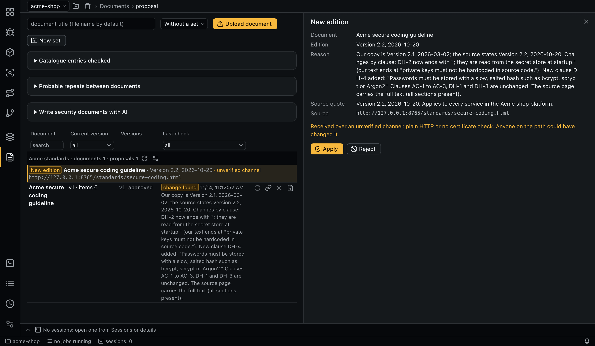

# Document refresher

The refresher compares documents with their online sources and creates proposals: new editions, new documents, replacements, retirements. A person applies them through the normal extraction and review.



## Sets

A set has a name, a description of what belongs to it, and links. A document belongs to at most one set.

Membership is set by a person; the agent only proposes new documents for the set it checks, based on the set's description. **New set** on the **Documents** tab creates a set. Removing a set keeps its documents outside any set. A plan of [AI-written documents](documents.md#security-documents-written-by-ai) creates its own set without links; those documents are updated with **Rewrite**.

## Running a check

| Check | Needs | Looks at |
|---|---|---|
| A whole set | A link on the set | The set's links only. Documents out of force are skipped, and the links of individual documents are not opened |
| One document | A link on the document (it may be outside any set) | That document only |

A check starts from the button on a set or document, `aiegis doc check`, or a [schedule](schedules.md). The estimate shows documents, links and tokens (from run history or configuration). Starting a check that is already active returns the active job.

Before starting an agent, the app re-downloads the sources of the last successful check and compares hashes:

| Result | Outcome |
|---|---|
| All match, same membership and links | No agent; status stays `current` |
| A site doesn't respond | `unverifiable`, no agent |
| **Run with AI anyway** (`--force`) | Agent always starts |

HTML hashes are computed over the text without menus, scripts and headers, and without lines matching `doc_refresh.volatile_lines` (view counters and the like). A page whose content changes in other ways, such as a rotating link block, starts the agent on every check; use an official source for such documents.

## How a set is checked

A set check has up to three parts:

| Part | Task | What it does |
|---|---|---|
| Overview | `doc_refresh` | Downloads the set's links, finds each document's page, hands pages and catalogues over with `request_document_review` and `request_catalogue_review` |
| Document comparison | `doc_review` | Reads both texts and decides. Has its own baseline and runs only if that document's page changed. A failed comparison drops the set's baseline so the next check repeats it |
| Catalogue pass | `doc_catalogue` | The app collects every same-host link from a listing page, drops already decided ones and splits the rest into batches of `doc_refresh.catalogue_batch`. Every entry needs a stored decision: an agent left to walk a long catalogue alone stops early. An undecided entry fails the run and returns in the next check. New entries are read once |

**Catalogue entries checked** on **Documents** and `aiegis doc catalogue <set>` show the decisions.

## Network limits

The agent has no `WebFetch`, `WebSearch`, shell or write access and reads only its own directory. The app downloads pages for it through the MCP tool `fetch_url`:

| Rule | Value |
|---|---|
| Protocols | `http`, `https` |
| Allowed hosts | Set check: hosts of the set's links. Document outside a set: its link's host. Document in a set: its link and the set's links (to find a replacement). The whole host is allowed, not only the path |
| Private addresses | Blocked at DNS resolution; `doc_refresh.allow_private_addresses` allows them (internal wiki) |
| Limits | `max_bytes`, `timeout_sec`, `max_redirects`; every request is logged |
| Redirects | Intermediate hosts may be any public host (an SSO service, for example); the agent doesn't see their content. The final host must be allowed. Cookies live in memory for one request |
| Certificates | `insecure` on a link disables verification for that host in the run, not for other hosts in a redirect chain. A document inherits the flag from a set link to the same host |

Content received over plain HTTP or without certificate verification is marked **unverified channel**: anyone on the network path could have modified it. Compare it with the source before applying.

## Pages and text

The app converts HTML to text without AI. The agent supplies the document's first and last phrase and the page order; the version is imported as MD with the source pages stored alongside. As a fallback the agent may submit its own text, labeled as restored by AI, if at least `doc_refresh.restored_min_coverage` of its paragraphs occur on the page; the review shows a warning for it. The `fetch_url` reply contains only the start of the page and the first `max_links` links; the full text and links go to files the agent reads.

Manual upload of `.html` isn't supported.

## Results and proposals

`current` and `unverifiable` results are stored directly. A refusing site or a document that can't be found gives `unverifiable`, and the last-check date stays unchanged. Changes become proposals:

| Kind | Meaning | When applied |
|---|---|---|
| `update` | A new edition of a document | A new version goes to extraction and review |
| `add` | A new document in the set | A new document in the set, added to the matrices you choose; by default those with documents of the set. Cells appear after approval |
| `replace` | A new document replaces this one | A new document in the same matrices. The old one goes out of force when the new one is first approved, and stays if the new one is discarded |
| `retire` | The document is no longer in force | The document goes out of force |
| `link` | A link was found for a document | The link is saved |

An `incomplete` result is a notice only: the source exposes part of the document, so no file is stored. Upload the file by hand; applying the notice just marks it handled.

Proposal states: `pending`, `applied`, `rejected`, `outdated`. A repeat check treats a matching pending proposal as a duplicate, and the document stays `changed`. A rejected proposal doesn't return while the source stays the same. A newer change at the source makes the older proposal `outdated`. Files of rejected and outdated proposals are deleted.

**Apply** and **Reject** are in the proposal's details. Bulk apply of additions works only for the first filling of an empty set.

## Rejected proposals

The MCP server rejects a proposal when:

- its quote is not in the text downloaded in this run (for an update by PDF or DOCX file, the evidence is a different hash and edition instead);
- an update adds no paragraph and removes at most `same_text_max_removed_lines` lines;
- an update has no edition;
- an update is shorter than `update_min_length_ratio` of the current text, which suggests only part of the document;
- a cut by start and end phrases keeps less than `crop_min_ratio` of the page, which suggests a wrong end phrase;
- a `retire` or `replace` has no quote.

A downloaded file that matches a document outside any set moves that document into the set; a match with a document in another set is an error.

## Settings

Limits: [`doc_refresh`](configuration.md#doc_refresh). Token limit for document runs: `limits.max_tokens_per_document_run`.

## Command line

```bash
aiegis doc-set save 'Internal standards' --scope 'Security standards of the company' --link https://wiki.example/standards/
aiegis doc-set list
aiegis doc-set assign <document> --set <set>
aiegis doc-set remove <set>
aiegis doc source <document> https://example.com/standard.pdf
aiegis doc check-estimate --set <set>
aiegis doc check --set <set>            # or --document <id>; --force always runs the agent
aiegis doc catalogue <set>
aiegis doc-proposal list
aiegis doc-proposal accept <proposal> [--matrix <id>]
aiegis doc-proposal reject <proposal> 'Not relevant to us'
aiegis doc-proposal accept-additions <set>
```

`--insecure-link` on `doc-set save` and `--insecure` on `doc source` and `doc import` skip the certificate check for that host.
