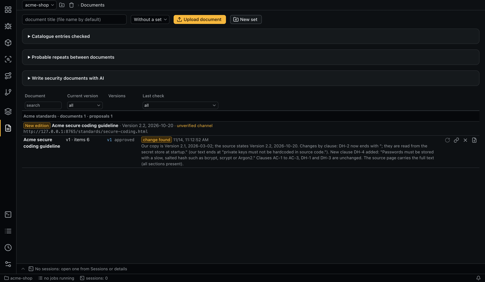
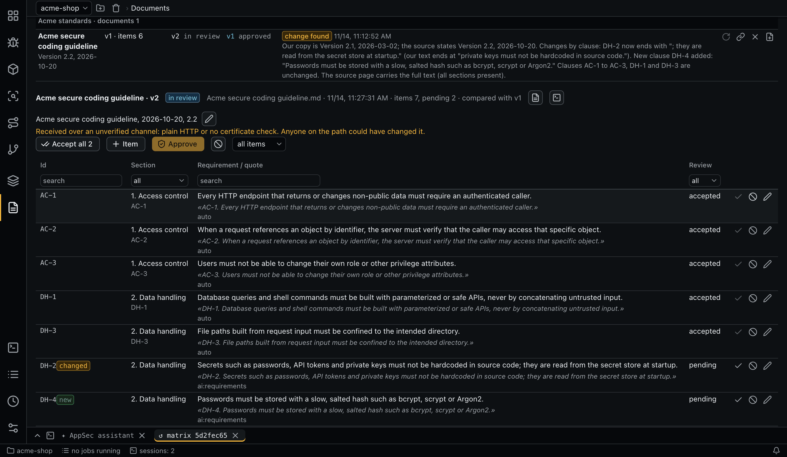

# Documents and requirements

Documents are the standards and guidelines you audit against. A document becomes usable only after a person reviews and approves its requirements.



Documents can come from three places:

1. [Uploaded files](#uploading-a-document): MD, PDF or DOCX.
2. [Written by AI](#security-documents-written-by-ai) from your code.
3. [The document refresher](document-refresher.md), which finds new editions and new documents at your links.

## Uploading a document

**Upload document** takes a title (the file name by default) and optionally a set. **Upload a new version** on an existing document adds a version. A new version cannot be uploaded while the document has an unfinished one, and a file identical to the current approved version is refused.

| Format | How the text is read | Are quotes checked? |
|---|---|---|
| MD | As is | Yes |
| DOCX | Converted to text | Yes |
| PDF | An agent (role `doc-text`) reads it into text once | Against that reading; the version is marked as read by AI, so compare important items with the file |
| PDF that could not be read | The extraction agent reads the PDF directly | No; the review shows a warning |

## Extraction

An agent (role `requirements`) records each requirement with its key, text, section, clause and a word-for-word quote:

- the key is the id from the document, or a generated `R-NNN` when there is none;
- a quote not found in the text is refused (case, whitespace, quote marks and Markdown markup are ignored in the comparison);
- the agent also records what the document says about itself: its name, number, date and edition;
- it records only what is printed. Nothing is worked out, and what is missing stays empty.

Version states:

| State | Meaning | What you can do |
|---|---|---|
| `extracting` | The agent is working | Watch the items appear |
| `review` | Ready for review | Review, approve |
| `failed` | The run failed | **Extract again**, go to the review if items exist, discard |
| `approved` | Read-only, in force | Change only how it is cited |
| `discarded` | Abandoned | Nothing |

## Document status and actions

The list groups documents by [set](document-refresher.md#sets). Each row shows the current version, the items, any pending proposals and the status of the last check: `current`, `change found`, `could not check` or `not checked`, with the date of that check. From a document or version you can open the source file, open the extraction session, or open the version's review.

## Review



Review is mandatory. The filter shows all items, pending items, or only new and changed ones. For each item you can **Accept**, **Reject** or **Edit**, or use **Accept all** and **Add an item manually**. Items you add or edit have the author `human` and are accepted at once.

**Approve** needs every item reviewed and at least one accepted. An approved version and its items can never change. The citation details (name, number, date, edition) are the exception: you can correct them later, because they name the version rather than state requirements.

## A new version of a document

The review compares a new version with the previous approved one, by key:

| Mark | Meaning |
|---|---|
| `new` | Not in the previous version |
| `changed` | The normalized text differs |
| `removed` | No longer present |
| unmarked | Unchanged |

To keep the wording stable, an accepted item whose quote still appears word for word in a new MD or DOCX file is carried over without AI: it gets the same key, text and section, the author `auto`, and is already accepted. The agent extracts only the rest. This happens once, at import, so **Extract again** does not overwrite your edits. You can still reject or edit a carried item.

The carry-over is correct if the quote covers the whole statement. If a quote is only part of a sentence and a different part of that sentence changed, the item is carried as unchanged. The extraction prompt asks for whole sentences for this reason. PDFs that could not be read into text are not carried over.

After approval:

- a changed requirement makes its matrix verdicts `stale`;
- a removed requirement leaves the matrices, and the history of its cells stays.

## Citations

So that a requirement can be attached as the reason for a task, a citation string is built from the version's name, number, date, edition and the item's clause. Only what is known appears, and a generated key `R-…` is left out. Citations appear in cell and finding details, in fix sessions, in probable repeats, and in `aiegis doc requirements`. Use **Change how this version is cited** or `aiegis doc info` to correct them.

## Security documents written by AI

**Write documents** covers your whole application in two steps, with the optional hints (focus, standards to follow, document language) applied to both:

1. **Plan** (task `doc_plan`, role `doc-author`, read-only): the agent studies the modules, entry point maps, build and security configuration, then records a plan. A document is a security domain such as authentication, authorization, or input handling, not a module, because the matrix already crosses every requirement with every module. The plan is refused if a live module is left uncovered or a generated document's key prefix changes.
2. **Writing** (task `doc_write`): one session per planned document. The text has a fixed format, which the app checks:

   ```markdown
   # Title

   A paragraph with the scope.

   ## Section

   - **AUTH-1** One requirement sentence.
     An indented line adds context for people.
   ```

A written document becomes a new version with no extraction run, because its items are parsed from the lines. It goes to the normal review. Sections become matrix groups, and the plan targets 3–10 requirements per section. The plan's documents go into one set named by the agent.

Generated documents are labeled `AI · PREFIX`, with the scope in a tooltip. **Rewrite** queues a new version with your hints: unchanged requirements are copied word for word, so they keep their history, and new requirements get higher numbers. A document with an unapproved version is skipped until you approve or discard it.

The app shows no estimate for generating documents.

## Probable repeats

**Probable repeats between documents** lists requirements in different documents that share at least `doc_refresh.repeat_min_similarity` of their words, with links to the sources. Nothing is merged.

## Out of force

**Out of force** takes a document out with a reason: its requirements leave the matrices and checks, while its history and findings stay. **Back into force** restores it, and anything that changed in between shows as `stale` by the normal rules. Documents are never physically deleted.

## New matrix

An approved version offers **New matrix**, which opens the normal [matrix form](matrix.md#creating-a-matrix) with this document selected.

## Command line

```bash
aiegis doc import ./guide.md --title 'Secure coding guideline'
aiegis doc list
aiegis doc show <version>
aiegis doc review <version> accepted <item>...
aiegis doc item <version> --text '...' --section 'Access control' --key AC-9
aiegis doc info <version> --name '...' --number '...' --date '...' --edition '...'
aiegis doc approve <version>
aiegis doc state <version> review       # or: discarded
aiegis doc retry <version>
aiegis doc plan --hint 'Focus on the payment flow'
aiegis doc rewrite <document> --hint '...'
aiegis doc retire <document> 'Replaced by the 2026 edition'
aiegis doc restore <document>
aiegis doc item-retire 'Not checkable in code' <requirement>...
aiegis doc item-restore <requirement>...
aiegis doc repeats
aiegis doc requirements
```

See the [CLI reference](cli.md#doc).
