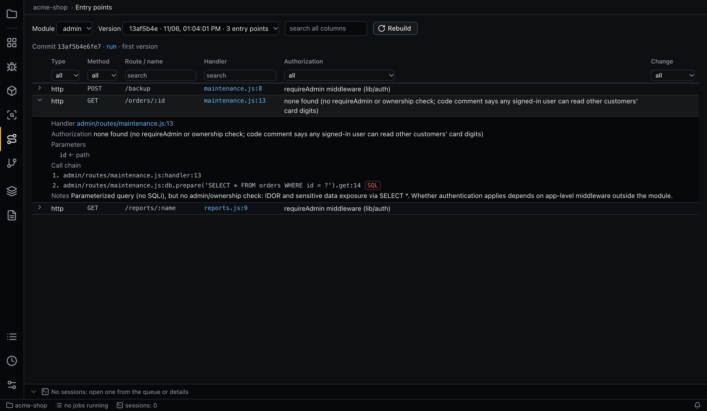

# Entry points

An entry point map lists how data gets into a module: its routes, handlers, consumers and commands, what guards them and where the input goes. Verdict sessions and document plans read it through MCP.



## What a record holds

| Field | Meaning |
|---|---|
| Type | `http`, `grpc`, `graphql`, `queue`, `cron`, `cli`, `websocket` or `plugin` |
| Method, route or name | For example `GET /api/orders/:id`. Type, method and name form the key of the record |
| Handler | `file:line`, relative to the repository root |
| Middleware | The middleware applied to it |
| Authorization | The requirements, as text |
| Parameters | Name, source, and optionally a type |
| Call chain | `file` and `function` steps, optionally with a line, down to sinks, which are marked |
| Notes | Anything else worth knowing |

`http` is only for routes the module registers itself. `plugin` is for methods a platform or framework calls with user data, such as SPI implementations, listeners and hooks. Its name has the form `Interface.method`, and the notes say which platform flow calls it and what input reaches it.

File paths must exist in the run's checkout.

## Building a map

**Build module map** (on this tab) and **Build map** or **Map all** (on **Modules**) queue a session per module. The role is `entry-points`, and the module's cascade level applies. While a job for a module is queued or running, a second one is not queued.

## Versions

Each map is a snapshot on a commit:

- a snapshot is `complete` when its run succeeds, and is then read-only;
- a failed run leaves an **incomplete** snapshot that is visible in the version list;
- the current map is the latest `complete` snapshot;
- each background run builds the map from scratch;
- an interactive continuation starts from a copy of its parent's snapshot and is `complete` when the session exits.

Choose a module and a version in the selectors, and use **Search all columns** to narrow the table. The table compares it with the previous complete version and marks each entry `new`, `changed`, `removed` or `unchanged`. Expand a row to see its middleware, parameters and call chain. Click a handler or call chain step to open it in VS Code.

A map is marked `stale` on **Modules** when the module's files or call chain files change after the snapshot. See [freshness](concepts.md#freshness-stale).

## Command line

```bash
aiegis entry-points build <module>
aiegis entry-points build-all
aiegis entry-points show <module> [--snapshot <id>]
```

Schedules can rebuild maps with the `entry_points` action. See [Schedules](schedules.md).
