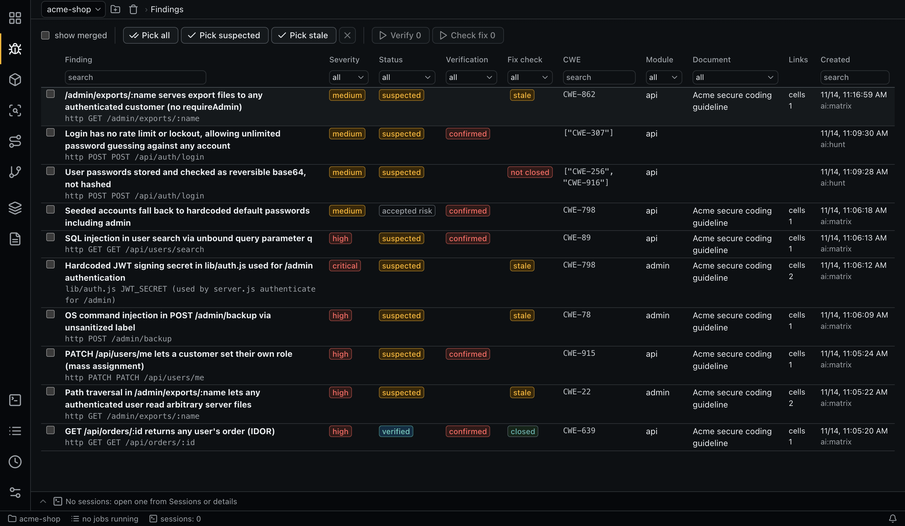
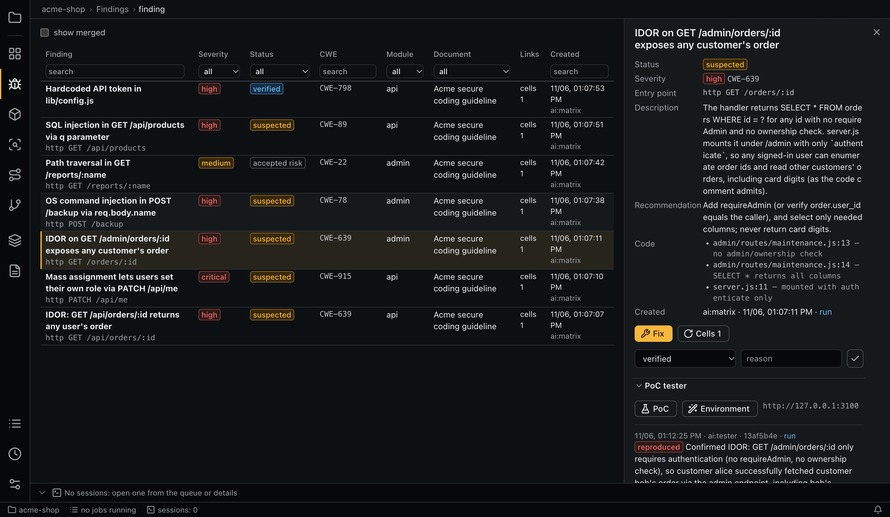

# Findings

A finding is one security problem, separate from the checks that found it. One finding can link to many matrix cells and SCA items.



## Lifecycle

```text
suspected → verified | false_positive | accepted_risk | fixed
```

Agents create findings as `suspected` and never change a status. Only people do, and `false_positive` and `accepted_risk` require a reason. A successful [PoC](poc.md) suggests `verified`, and an [independent verification](#independent-verification) gives a second opinion, but you set the status.

A finding itself cannot change; its state comes from an append-only list of events (`created`, `status`, `link`, `merged`).

## Fields

Title, description, severity, CWE, entry point, files, recommendation, module. Severity uses one scale for findings and signals.

## Where findings come from

- Matrix verdicts (`create_finding`, `link_finding`).
- SCA reachability (`create_sca_finding`, `link_sca_finding`).
- Manual input: **Finding** on a cell or an SCA item.

## Deduplication

Before creating a finding, an agent must call `find_similar`. It ranks live findings: the same entry point scores +3, the same CWE +2, shared files up to +3. A finding scoring at least 3 is a candidate, and up to `findings.similar_limit` are returned. `create_finding` is refused without the `check_id` issued to that run, and if a candidate is the same flaw, the agent links to it instead.

You can also merge by hand. The **Similar (manual merge)** section offers **Into current** and **Current into it**: the source becomes a link to the target, and its cells move to the target. Links to a merged finding go to its target. Merged findings are hidden unless you tick **show merged**.

## The table

Columns: picker, finding, severity, status, verification, CWE, module, document, links (the number of cells) and created. The filters work like all [table filters](interface.md#tables). The document filter goes through the requirements of the linked cells.

## Details



- **Status** with **Change the status**.
- Description, recommendation, entry point and files.
- **Cells**, which rechecks the linked matrix cells after an estimate.
- **Matrix cells** and **Vulnerable dependencies (SCA)** linked to the finding.
- **Similar (manual merge)**.
- **[Independent verification](#independent-verification)** with **Verify**.
- **[PoC tester](poc.md)** with **Environment**.
- **Sessions**: the agent sessions behind the finding; any of them can be reopened.
- **History**: its events.
- **Fix**, which opens a [fix session](#fix-sessions).

## Independent verification

An agent that refutes its own finding in the same session tends to defend it. **Verify** runs a separate background session of the role `finding-verify` whose only goal is to refute a `suspected` finding. It needs no running environment, unlike the [PoC tester](poc.md).

- **Clean session.** It gets what the finding states and its code locations, as JSON that it must treat as data. It does not get the recommendation, the notes on the code references, the author or the run. Its MCP token reaches only `whoami` and `set_finding_verification`, so verdict reasons, runs and other findings are out of reach. It reads only its checkout, which keeps the transcript of the original session out of reach too.
- **Code.** A read-only worktree at the commit of the session that made the finding. A manual finding has no such commit, so it uses HEAD at the time of the run.
- **Method.** It reads the source only: it writes no exploits, runs no code and probes no system.
- **Result.** One of the outcomes below, with a reason. Results are only added, never changed. The latest one is shown in the **Verification** column.
- **Status.** The result never changes the status: you decide.

| Outcome | Meaning | Code references |
|---|---|---|
| `refuted` | The code shows that the claimed fact or the claimed effect is false | Required |
| `confirmed` | It tried to refute the claim and could not. A true claim that matters less than it says is still `confirmed`, and the reason says why the impact is lower | Required |
| `undetermined` | The repository does not decide it (deployment, proxy, identity provider), or the session could not finish. The reason names the deciding fact | Optional |

Read the reason before you set a status. For example, `confirmed` with a note on low impact may lead to `accepted_risk`, not `verified`.

To verify several findings, tick them in the table (**Pick suspected** takes the ones the filters show), press **Verify** in the toolbar and confirm the estimate. Each finding takes its own session. The estimate uses the average of recent runs of the role (`findings.verify_estimate_history_runs`), or `findings.verify_estimate_tokens`. In a test on a large repository, sessions with the default model and effort took 12k to 25k billable tokens, about 18k on average.

The **Verify** button of a single finding starts at once, without an estimate, like **PoC**.

The check does not replace your judgement. In that test, on 11 claims written by hand, the outcome matched the expected one in 10 and the eleventh was arguable. That shows the role works, not how accurate it is on real findings: the sample is small and the cases were clear on purpose.

Model, effort, prompts and permissions come from the role and the task `finding_verify`, like any [role](configuration.md). A safety filter of the model provider can stop a run. See [Provider safety filters](security.md#provider-safety-filters).

## Fix sessions

**Fix** starts an interactive session of the role `assistant` in your working directory, not a worktree, with the finding as the initial prompt (task `fix`). It can edit your code, so review the result. When a commit appears after the session ends, the app [offers to recheck](matrix.md#rechecking-after-a-fix). This is a normal agent session; there is no separate fix generator.

## Command line

```bash
aiegis finding list
aiegis finding show <finding>
aiegis finding status <finding> false_positive 'Only reachable by administrators'
aiegis finding verify-estimate <finding...>
aiegis finding verify <finding...>
aiegis finding merge <source> <target>
aiegis finding create <cell> --title '...' --description '...' --severity high --cwe CWE-639 --evidence api/orders.js:12
aiegis finding link <finding> <cell>
aiegis finding poc <finding>
```

Fix sessions need a terminal, so they exist only in the desktop app.
