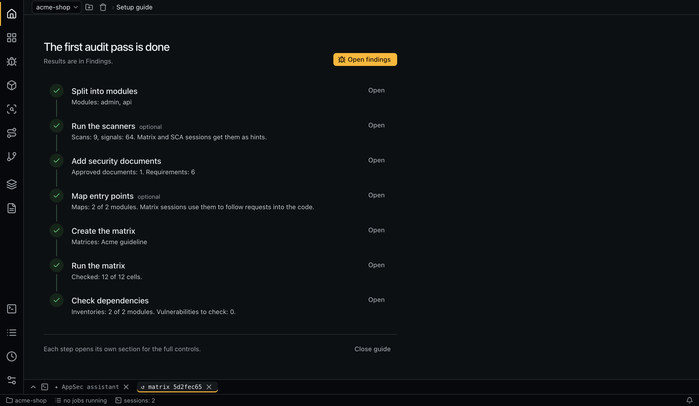

# Getting started

## Requirements

- `git`.
- A coding agent, installed and logged in:
  - [Claude Code](https://docs.claude.com/en/docs/claude-code/setup) (`claude` on `PATH`), the default; or
  - [pi](https://pi.dev) (`npm install -g @earendil-works/pi-coding-agent`, `pi` on `PATH`, a provider configured in pi itself) with `agent: pi` in `~/.aiegis/config.yaml`. See [Agents](agents.md).
- Optional scanners on `PATH`: `semgrep`, `gitleaks`, `trivy` (macOS: `brew install semgrep gitleaks trivy`). A missing scanner is skipped with a warning.
- Optional: VS Code, to open `file:line` references.

At startup the app reads `PATH` from the login shell, so tools available in a terminal are found when the app starts from Finder or the Dock as well.

## Install

Download a build from the [releases page](https://github.com/seelentov/aiegis/releases/latest):

| Platform | File |
|---|---|
| macOS (Apple Silicon) | `aiegis-<version>-mac-arm64.dmg` or `.zip` |
| Windows x64 | `aiegis-<version>-win-x64.exe` |
| Linux x64 | `aiegis-<version>-linux-x86_64.AppImage` or `-linux-amd64.deb` |
| Linux x64, arm64: [service without a window](service.md) | `aiegis-<version>-linux-x64`, `aiegis-<version>-linux-arm64` |

Builds are not signed. On macOS, right-click the app and choose **Open** the first time, or run `xattr -dr com.apple.quarantine /Applications/aiegis.app`.

To run from source:

```bash
git clone https://github.com/seelentov/aiegis.git
cd aiegis
npm install
npm run setup      # rebuilds node-pty for Electron
npm start
```

macOS is the main platform. Windows and Linux builds are built in CI and tested less.

## First start

1. Start aiegis.
2. The [setup guide](interface.md#setup-guide) opens. Click **Add project** and pick the root of a git repository. The guide lists the steps below with their state and next action; it opens again for each project added later.
3. Default settings are copied to `~/.aiegis/`: `config.yaml` and the role and task prompts. They are editable on the **Settings** tab, see [Configuration](configuration.md).

The interface language is English. For Russian, set `ui.language: ru` in **Settings → Global → Interface**; the window reloads on save.

## A first audit



The setup guide follows the same order. Each step links to its page.

1. Set cheap models for a trial run in `<repo>/.aiegis/config.yaml`:

   ```yaml
   roles:
     modules: { model: haiku, effort: low }
     requirements: { model: haiku, effort: low }
     matrix-triage: { model: haiku, effort: low }
     matrix: { model: sonnet, effort: low }
   limits:
     max_tokens_per_run: 150000
   ```

2. Split the repository into [modules](modules.md): **Mark up** on the **Modules** tab asks the agent; modules can also be added by hand.
3. Build [entry point maps](entry-points.md) with **Map all** on **Modules**, one session per module.
4. Upload a [document](documents.md) on **Documents**: a standard or an internal guideline in MD, PDF or DOCX. The agent extracts requirements with quotes; you approve them. Without a document of your own, **Write documents** under **Write security documents with AI** has the agent write one from the code.
5. Create a [matrix](matrix.md) from the approved documents and modules and run **n/a triage**, then **Verdicts**. Each run shows an estimate of sessions and tokens before it starts. For flaws the requirements don't cover, run a [vulnerability hunt](modules.md#vulnerability-hunt) with **Hunt** on **Modules**; it reads every file and costs more than the matrix.
6. Triage the [findings](findings.md): set `verified`, `false_positive` or `accepted_risk`, or open a fix session. The [PoC tester](poc.md) reproduces a finding against a test instance.
7. Run the [dependency](sca.md) inventory and the reachability check; suppress noisy [scanner signals](signals.md) with a reason.
8. After new commits, verdicts whose evidence changed become `stale`; only they need a recheck. [Branch checks](branch-check.md) review a branch before merge, the [document refresher](document-refresher.md) detects new editions of documents, [schedules](schedules.md) run any of this on cron.

## Next

- [Concepts](concepts.md): roles, runs, worktrees, the cascade.
- [Interface](interface.md): layout and keyboard shortcuts.
- [Security](security.md): what agents can and can't do.
