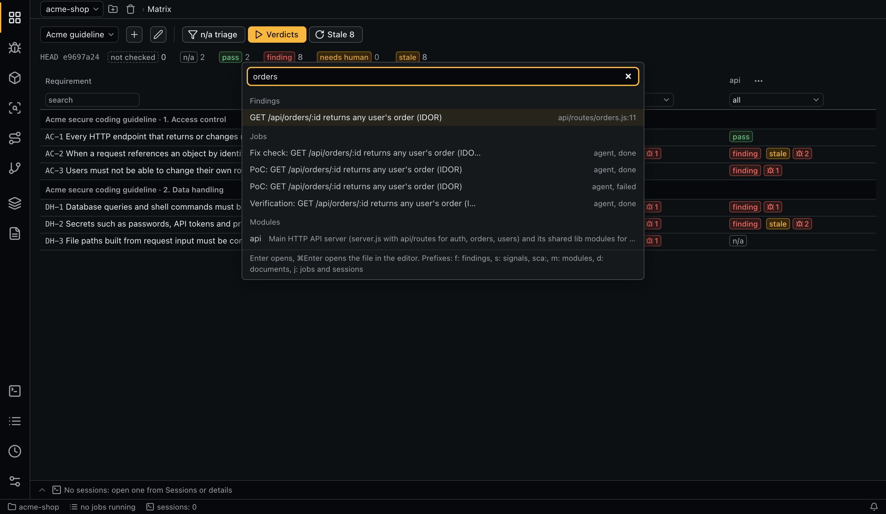

# Interface

The layout follows VS Code.

| Area | Position | Content |
|---|---|---|
| Activity bar | Far left | Tabs by group; the [setup guide](#setup-guide) on top while open. The **Queue** badge counts running jobs |
| Header | Above the content | Project picker with **Add git repository** and **Remove the project from the list**; breadcrumbs (tab › selected item); a progress line on the lower edge while jobs run |
| Session list | Left of the content | Only on the [Sessions](queue-and-sessions.md#sessions-tab) tab; can be hidden |
| Details panel | Right | Opens on row selection; closes with the cross or `Esc`. Collapsed sections are remembered by name. Selecting another row replaces the panel and discards unsaved forms in it |
| Terminal panel | Bottom | Read-only output streams and interactive sessions, see [Queue and sessions](queue-and-sessions.md#terminal-panel) |
| Status bar | Bottom edge | Project (opens **Sessions**), running jobs or paused queue (opens **Queue**), session count (opens the terminal), notification bell |

## Tabs and keyboard shortcuts

`⌘` on macOS, `Ctrl` elsewhere.

| Shortcut | Tab | Group |
|---|---|---|
| `⌘1` | [Matrix](matrix.md) | Audit |
| `⌘2` | [Findings](findings.md) | Audit |
| `⌘3` | [SCA](sca.md) | Audit |
| `⌘4` | [Signals](signals.md) | Audit |
| `⌘5` | [Entry points](entry-points.md) | Audit |
| `⌘6` | [Branch check](branch-check.md) | Audit |
| `⌘7` | [Modules](modules.md) | Sources |
| `⌘8` | [Documents](documents.md) | Sources |
| `⌘9` | [Sessions](queue-and-sessions.md#sessions-tab) | System |
| `⌘0` | [Queue](queue-and-sessions.md) | System |
| none | [Schedules](schedules.md) | System |
| none | [Settings](configuration.md#the-settings-tab) | System |

| Shortcut | Action |
|---|---|
| `⌘B` | Show or hide the session list on **Sessions** |
| `⌘J` | Show or hide the terminal |
| `⌘P`, `Shift` twice | [Search everywhere](#search-everywhere) |
| `⌘⇧P` | [Command palette](#command-palette) |
| `Ctrl+Tab`, `Ctrl+Shift+Tab` | Switch to the recently used tabs; hold `Ctrl` and press `Tab` again to go further back |
| `Ctrl+-`, `Ctrl+Shift+-` (macOS); `Alt+←`, `Alt+→` (elsewhere) | Go back and forward over tabs and opened items; the mouse back and forward buttons do the same |
| `↑`, `↓` | Select the previous or next row of the table with a selected row, opening its details |
| `Esc` | Close the details panel (not while typing in a field or in the terminal) |

Double `Shift` does not open search while the terminal has focus; use `⌘P` there.

## Search everywhere

`⌘P` or double `Shift` searches the whole project: findings, signals of the commit **Signals** opens on, suppressions, SCA vulnerabilities, modules, documents and their proposals, matrices, branch checks, schedules, jobs and free sessions. An item matches when every query word occurs, case-insensitively, in its id, title, details (severity, status, CWE, scanner, rule, package) or `file:line`. Exact id matches rank first, then titles starting with the query.

Results are grouped by kind. `↑`/`↓` move the selection. `Enter` opens the item's tab, selects the row, opens its details and scrolls to it, switching the page and clearing filters that hide it. `⌘Enter` opens the item's file at its line in VS Code. An empty query lists recently opened items.

A prefix narrows the search: `f:` findings, `s:` signals and suppressions, `sca:` SCA, `m:` modules, `d:` documents, proposals and matrices, `j:` jobs, sessions, schedules and branch checks. For example, `f: sql orders`.

**Queue** rows aren't scrolled to; a found job opens only in the details panel.

## Command palette

`⌘⇧P`, or `>` typed in search everywhere, lists commands: go to any tab, go back or forward, start a session, show or hide the session list and the terminal, maximize or move the terminal panel, close finished or all terminal tabs, switch to an open terminal, collapse or expand all detail sections, show or clear notifications, add a project or switch to another one.

## Context menus

Context menus:

| Target | Items |
|---|---|
| Text fields, selected text | Cut, Copy, Paste, Select all |
| Table rows | Open; open the cell's `file:line` in VS Code; copy the cell, the row or all visible rows (TSV with headings); filter the column by the cell value; hide the column |
| Table headings | Sort ascending or descending; reset filters and sorting; show or hide columns (remembered per machine) |
| Section headings in the details panel | Collapse or expand all, copy the item id, close the details |
| Dividers | Reset size; on the terminal divider, also move the panel |
| Terminal tabs and output, session list | See [Queue and sessions](queue-and-sessions.md#terminal-panel) |

## Projects

The project picker in the header switches projects and accepts a search query. **Add git repository** opens a folder dialog; the folder must be a git repository. The project id is derived from the real path of the root, so a moved repository becomes a new project.

**Remove the project from the list** removes it from the app only. Audit data stays on disk; adding the same path restores it. See [Data and logs](data-and-logs.md).

## Setup guide

The setup guide replaces the tab content on first launch with no projects and after each added project (then without the project step). Steps: choose a project, split it into modules, run scanners, add security documents, map entry points, create and run the matrix, check dependencies. Each step reads its state from the project, shows what is done or running and offers the next action; **Open** switches to the step's tab. Optional steps can be skipped.

The guide stays at the top of the activity bar until **Close guide**.

## Tables

All tables share the same behavior:

- a click on a column heading sorts;
- the field under the heading filters by text or value; text filters are case-insensitive for any alphabet;
- filters are kept until restart; **Reset filters and sorting** clears them;
- pages hold `ui.page_size` rows (see [Configuration](configuration.md)); changing a filter or sort returns to page 1.

Histories in the details panel are paged by `ui.history_page_size`. In the document list a set's heading repeats on each page the set spans.

**Queue** tables hold every job and run; paging, filtering and sorting happen in the core. Date filters match the stored UTC form, such as `2026-11-01`; tokens and cost are sortable but not filterable.

Table-wide actions (**Pick suspected**, **Pick stale**, the run button of a matrix section) apply to every row that passes the filters, on all pages.

Row and toolbar actions are icons with tooltips; form buttons such as **Save** and **Cancel** are text.

## Dropdown lists

Every dropdown is searchable. All query words must match, in any order: `oauth fix` finds `fix/oauth-token`. Lists of 7+ items always show the search field; shorter ones show it once you type. On a closed dropdown a letter or an arrow key opens it. Inside the list, arrows move, `Enter` picks, `Esc` or `Tab` closes.

## Resizing

Dividers resize the session list, the details panel and the terminal, by mouse or by arrow keys when focused. Double-click or **Reset size** in the context menu restores the default. Sizes and the last open tab are stored per machine.

The terminal panel docks at the bottom or the right: **Move the panel to the right** / **to the bottom** in the context menu of its tab bar or divider, or in the command palette. The position is remembered. The maximize button or a double-click on the tab bar makes it fill the work area.

## Notifications

The bell in the status bar keeps the session's last 50 notifications and counts unread warnings and errors. Sources: unavailable scanners, defaults added by an upgrade, schedules that failed to start, recheck offers after a commit.

## Effective configuration

Modules, cells, dependency items, runs and **Settings** show the effective configuration: the resolved value of each field (agent, model, effort, instructions, permissions, env) and the cascade level it came from. See [Configuration](configuration.md#effective-configuration).

## Opening files

File references open in VS Code in the working copy, at the line if known. A reference from another commit may point to shifted lines; the signals table warns about it.

## Language

`ui.language` in the global configuration: `en` or `ru`. Role and task titles follow it. Core errors, notifications and MCP replies are always English.
