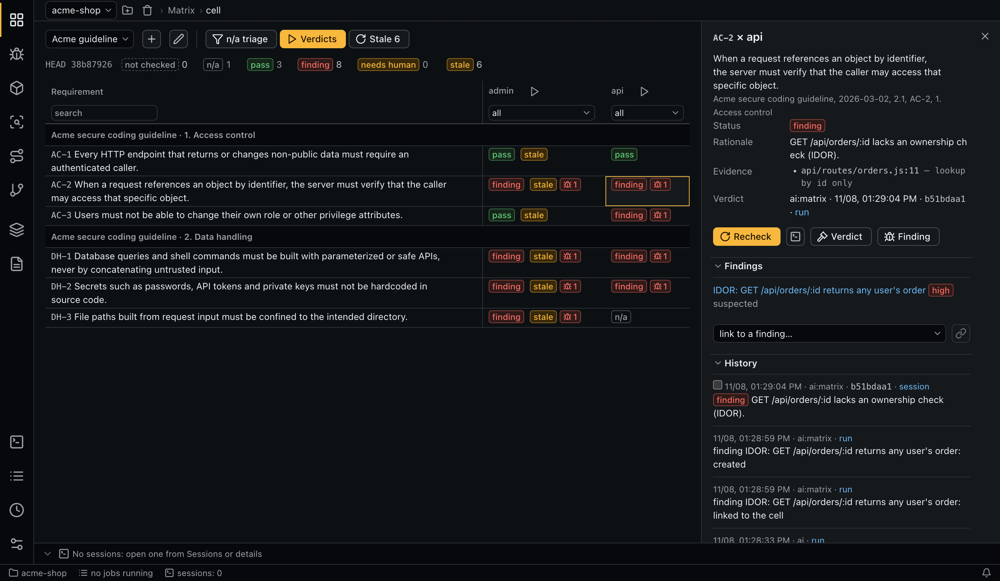
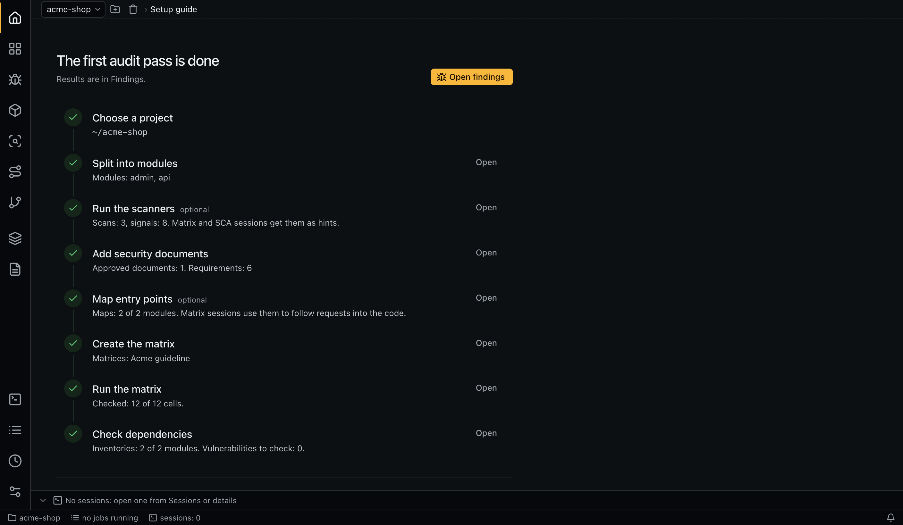

# Interface

The layout follows VS Code:

- **Activity bar** (far left): the tabs by group, and the [setup guide](#setup-guide) on top while it is open. A badge on **Queue** shows how many jobs are running.
- **Header** above the content: the project picker with **Add git repository** and **Remove the project from the list**, then the breadcrumbs: tab › selected item. A progress line runs along its lower edge while jobs are running.
- **Session list** (left of the content): shown only on the [Sessions](queue-and-sessions.md#sessions-tab) tab, and can be hidden.
- **Details panel** (right): opens when you select a row. Close it with the cross or `Esc`. Its sections collapse, and the app remembers their state by section name. Selecting another row clears the panel at once, along with any unsaved form in it.
- **Terminal panel** (bottom): tabs with read-only output streams and interactive sessions. See [Queue and sessions](queue-and-sessions.md#terminal-panel).
- **Status bar**: the project (opens **Sessions**), jobs in progress or a paused queue (opens **Queue**), the number of sessions (opens the terminal), and the notification bell.

## Tabs and keyboard shortcuts

`⌘` on macOS, `Ctrl` elsewhere.

| Shortcut | Tab | Group |
|---|---|---|
| `⌘1` | [Matrix](matrix.md) | Audit |
| `⌘2` | [Findings](findings.md) | Audit |
| `⌘3` | [SCA](sca.md) | Audit |
| `⌘4` | [Signals](signals.md) | Audit |
| `⌘5` | [Entry points](entry-points.md) | Audit |
| `⌘6` | [Branch check](branch-check.md) | Audit |
| `⌘7` | [Modules](modules.md) | Sources |
| `⌘8` | [Documents](documents.md) | Sources |
| `⌘9` | [Sessions](queue-and-sessions.md#sessions-tab) | System |
| `⌘0` | [Queue](queue-and-sessions.md) | System |
| none | [Schedules](schedules.md) | System |
| none | [Settings](configuration.md#the-settings-tab) | System |

| Shortcut | Action |
|---|---|
| `⌘B` | Show or hide the session list on **Sessions** |
| `⌘J` | Show or hide the terminal |
| `Esc` | Close the details panel (not while typing in a field or in the terminal) |

## Projects

The project picker in the header switches between projects; type in it to search. **Add git repository** opens a folder dialog; the folder must be a git repository. A project's id is derived from the real path of its root, so moving a repository makes it a new project.

**Remove the project from the list** forgets the project in the app. Its audit data stays on disk, and adding the same path again brings it back. See [Data and logs](data-and-logs.md).

## Setup guide

A setup guide opens in place of a tab on the first launch with no projects, and again each time you add a project; then it starts without the step of choosing one. It walks from an empty project to the first findings: choose a project, split it into modules, run the scanners, add security documents, map entry points, create and run the matrix, and check dependencies. Each step reads its state from the project, shows what is done or running, and offers its next action; **Open** goes to the step's tab for the full controls. Optional steps can be skipped.

The guide stays on top of the activity bar until **Close guide**.

## Tables

Every table works the same way:

- click a column heading to sort;
- use the field under the heading to filter by text or by value; text filters ignore case in any alphabet;
- filters last until the app restarts;
- **Reset filters and sorting** clears them;
- long tables are split into pages, with `ui.page_size` rows on each (see [Configuration](configuration.md)). A change of filter or sorting returns to the first page.

Histories in the details panel are paged too, by `ui.history_page_size`. In the list of documents a set stays together: its heading repeats on each page it spans.

The tables of the **Queue** tab hold every job and run, not only the latest ones: the service pages, filters and sorts them. Dates there are filtered by their stored form in UTC, such as `2026-11-01`; tokens and cost only sort.

Actions on a table work on every row that passes the filters, not only on the current page: **Pick suspected**, **Pick stale** and the run button of a matrix section.

Row and toolbar actions are icons with a tooltip. Form buttons such as **Save** and **Cancel** are text.

## Dropdown lists

Every dropdown can be searched:

- type to narrow the list. Every word must match, in any order: `oauth fix` finds `fix/oauth-token`;
- lists of 7 or more items always show the search field; in shorter ones it appears when you start typing;
- on a closed dropdown, a letter opens it with that letter in the search, and the arrow keys open it;
- inside the list, the up and down arrows move, `Enter` picks and `Esc` or `Tab` closes.

## Resizing

Drag a divider to resize the session list, the details panel or the terminal. With the keyboard, focus a divider and use the arrow keys. Double-click a divider to restore its default. Sizes and the last open tab are remembered on this machine.

The terminal can also fill the whole work area: use its button or double-click its tab bar.

## Notifications

The bell in the status bar keeps the last 50 notifications of the session and counts unread warnings and errors. Notifications include scanners that are unavailable, default settings added after an upgrade, schedules that did not start, and offers to recheck after a commit.

## Effective configuration

Modules, cells, dependency items, runs and **Settings** can show the effective configuration: the final value of each field (agent, model, effort, instructions, permissions, env) and the level it came from. See [Configuration](configuration.md#effective-configuration).

## Opening files

File references open in VS Code in your working copy, at the line when one is known. If the reference belongs to another commit, the lines may differ; the signals table warns you about this.

## Language

Set `ui.language` to `en` or `ru` in the global configuration. Role and task titles follow it too. Errors from the core, notifications and MCP replies are always in English.
