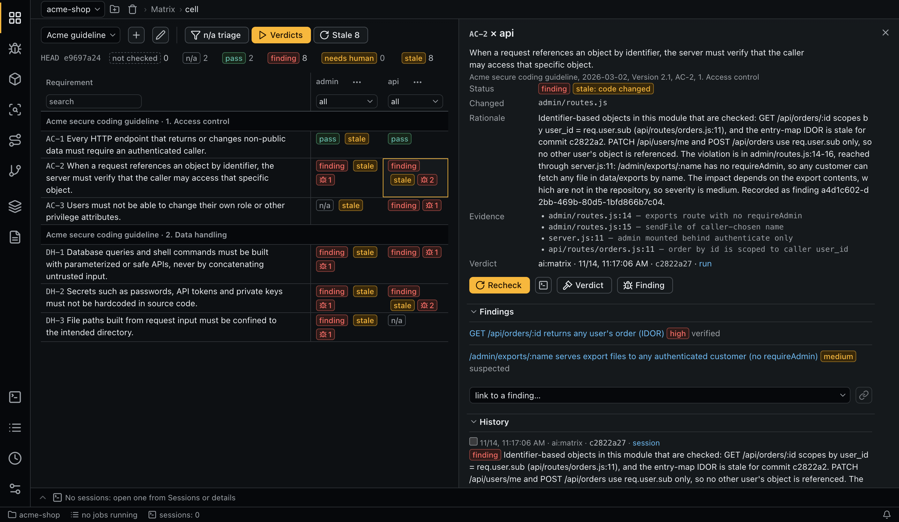
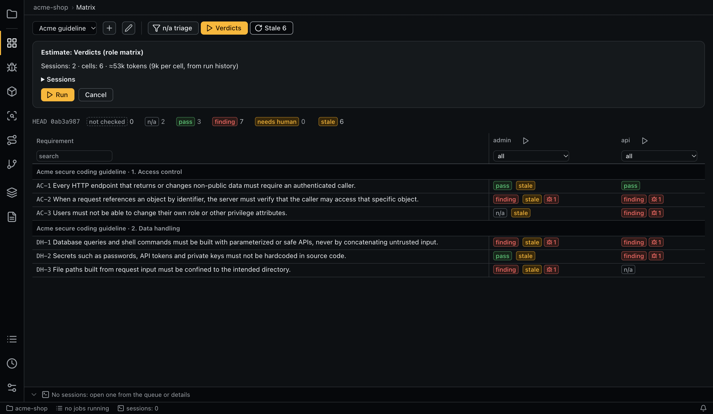

# Matrix

A matrix crosses requirements with modules. Each cell gets its own verdict with a reason and code references.



## Creating a matrix

A matrix has a name, documents (their approved versions) and modules. With no modules selected, it means all current modules. Click **+** to create one and the pencil to edit it.

A cell is global: a verdict for a module and a requirement is shared by every matrix that contains that cell.

## Cell statuses

| Status | Meaning | The verdict needs |
|---|---|---|
| `not checked` | No verdict yet | |
| `n/a` | The requirement does not apply to this module | A reason |
| `pass` | The requirement holds | A reason and code references |
| `finding` | The requirement is broken | A reason, code references and a linked finding |
| `needs human` | The agent could not decide | A reason |

A `pass` must cite the code that meets the requirement. The agent checks every place in the module that does what the requirement is about, and a control it did not find is a violation or `needs human`. A `pass` argued from silent scanners is rejected.

`stale` is a separate flag on top of a status: the code or the requirement changed after the verdict. See [freshness](concepts.md#freshness-stale). `applicable` marks a cell the triage left for the verdict stage; the cell stays `not checked`.

The counters above the grid filter the rows. The grid is grouped by document and section, and the header shows which commit the verdicts are displayed for.

## Running checks

Every run opens an [estimate](#estimates) first.

| Button | Stage | Cells it takes |
|---|---|---|
| **n/a triage** | Stage 1 (role `matrix-triage`, a cheap model) | `not checked` without a triage mark. One session per module, up to `matrix.triage_batch_size` cells |
| **Verdicts** | Stage 2 (role `matrix`) | All `not checked`. One session per module × section, up to `matrix.batch_size` cells |
| **Stale** | Stage 2 | All `stale` cells, in any status |
| ▷ on a column, row or section | Stage 2 | The `not checked` and `stale` cells of that slice, or all of them if there are none |
| **Recheck** in the details | Stage 2 | The selected cell |

Cells already covered by a queued or running job are skipped. A cell with its own `requirements.<key>` configuration level gets a separate session so that the level applies.

Runs are atomic per cell: a verdict is written as soon as it is decided. After a crash, a rate limit or a token limit, **Retry** takes only the cells with no result and rebuilds the prompt. If nothing is left, the job finishes without starting the agent. A successful run that leaves cells without a verdict ends with an error, so that **Retry** can pick them up.

With `signals.auto_scan` on, missing scans of the batch's modules are queued first, and verdict sessions wait for them without blocking other jobs. Agents get signals as hints only. See [Signals](signals.md).

### Estimates



The estimate shows sessions, cells and tokens (cells × tokens per cell). The per-cell figure is the average billable tokens over the last `matrix.estimate_history_runs` successful runs of the role, or `matrix.estimate_tokens_per_cell` when there is no history. A warning appears when a session may exceed `limits.max_tokens_per_run`; lower `matrix.batch_size` or raise that limit.

The token limit counts input, cache creation and output tokens, not cache reads. A run over the limit is stopped with the status `token_limit`.

### Merged sessions for large runs

A verdict run estimated above `matrix.economy_above_tokens` (one million tokens) goes as a few merged sessions (task `matrix_economy`, role `matrix-economy`): the agent reads the code once and decides requirements in groups. A module's cells stay together, up to `matrix.economy_batch_size` per session, and modules with few cells share one. Cells with their own cascade level keep usual sessions.

This is several times cheaper, but merged sessions miss more, including wrong `pass` verdicts. Their verdicts are preliminary: a star in the cell, a label in the details and a filter above the grid. **Preliminary** checks them again in usual sessions; any later verdict removes the mark.

The estimate panel shows both totals and switches the mode, `--force` keeps usual sessions on the command line. A retry keeps the mode of the job. Schedules follow the threshold. Set the threshold to `0` to turn merged sessions off.

## Cell details

- The requirement, its citation and the quote.
- The status, rationale and evidence, with links to the code.
- Who decided it, when and on which commit, and a link to the run.
- **Recheck**, the verdict session, **Verdict** (set manually), **Finding** (create manually), and **Link the finding to the cell**.
- **Findings** linked to the cell.
- **History**: verdicts, triage and finding events. Tick two verdicts to **compare** them: status, author, commit, model and effort, rationale and evidence.
- **Effective configuration of the check**.

A manual verdict is recorded with the author `human` on the `HEAD` of your working copy, and its evidence is checked there. Evidence is one reference per line: `path[:line] [note]`, from the repository root.

## Rechecking after a fix

After an interactive session makes a commit in your working directory, the app notices the change in `HEAD` and offers to recheck the finding's cells (for a fix session) and the cells whose verdicts depend on the changed files. The offer stays until you act on it, and leads to an estimate and a confirmation. A cell in several matrices uses the level of the matrix it was opened from, or the first by name.

## Command line

```bash
aiegis matrix list
aiegis matrix save 'Guideline' --document <id> --module api --module admin
aiegis matrix show <matrix>
aiegis matrix estimate <matrix> --stage verdicts --scope pending
aiegis matrix run <matrix> --stage triage
aiegis matrix run <matrix> --stage verdicts --scope stale
aiegis matrix run <matrix> --module api            # also --requirement, --section
aiegis matrix slice <matrix> --module api
aiegis cell show <module id>/<requirement id>
aiegis cell estimate <cell>...
aiegis cell run <cell>...
aiegis cell verdict <cell> pass 'Checked by the middleware' --evidence lib/auth.js:12
```

Run commands show the estimate and ask for confirmation; `--yes` skips this. See the [CLI reference](cli.md#matrix).
