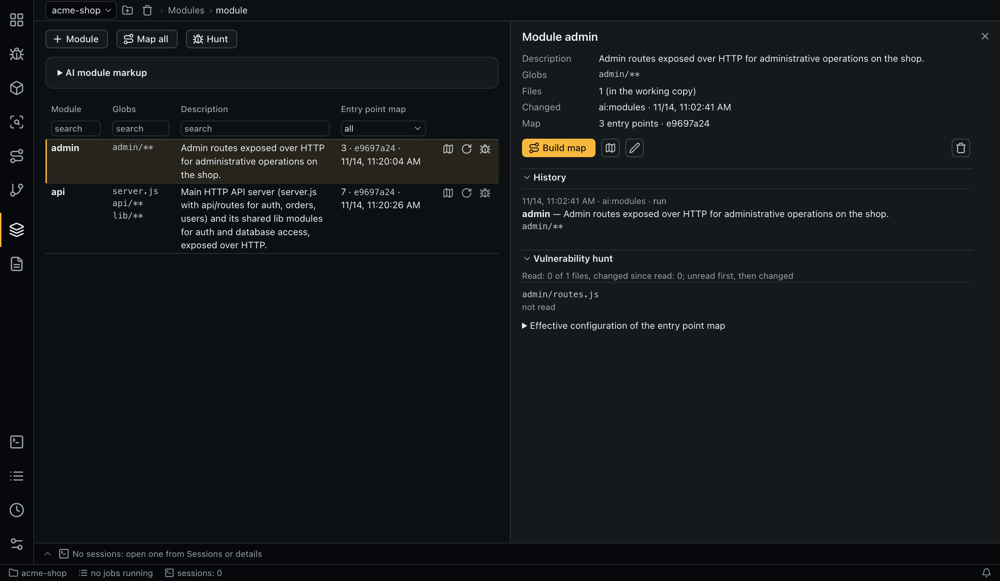

# Modules

A module is a name, a set of globs and a description. The globs are the source of truth: they decide which files belong to the module. Every check that works per module (entry point maps, matrix verdicts, SCA) uses them.



## Globs

Globs are git pathspec globs, relative to the repository root:

- `*` does not cross `/`, `**` does;
- a leading `!` excludes;
- at least one including glob is required.

A module's files are the tracked files (`git ls-files`) that match. **Check globs** shows the count and a sample before you save. Globs that match no file are refused.

## Creating and changing modules

- **Module** adds one by hand.
- **Mark up**, under **AI module markup**, runs the agent (role `modules`). The optional hints say which parts of the repository to mark up and how to name them. A new markup does not erase your edits: each change is a new revision.
- In the details panel you can edit a module, or delete it with a required reason.

Revisions are append-only. The details panel shows the history with the author (`human` or `ai:modules`) and the run. Saving without changes creates no revision, and names are unique among live modules.

A module's agent, model, instructions and permissions can be overridden in the project configuration under `modules.<name>`, matched by name. See the [cascade](configuration.md#the-cascade).

## Module columns and details

The table shows each module's name, globs, description and entry point map, including whether the map is `stale`. The details panel adds:

- the globs and the number of files;
- the revision history;
- the effective configuration of the map, including the module level;
- **Build map** or **Rebuild map**, **Open map**, and **Watch output** while a job runs.

**Map all** queues a map for every module.

## Vulnerability hunt

The matrix finds what the requirements name. **Hunt** (toolbar: the modules shown under the filters; row: one module) looks for exploitable flaws of any kind: sessions of the role `hunt` read every file of the module and record findings that are not tied to a requirement.

- Files are the module's files minus `hunt.exclude` (tests, vendored and generated code, docs by default), split into sessions of `hunt.batch_files`. The run goes through an [estimate](queue-and-sessions.md); without an entry point map the estimate warns and offers **Build maps**.
- A session marks each file it finished (`mark_files_reviewed`). A successful run that left files unread fails, and **Retry** reads only those.
- Findings (`create_hunt_finding`) need `find_similar` first, belong to the module, have no matrix cells and usually carry a [data flow](findings.md#fields). Their status is set by a person, as for any finding.
- The module's details show **Vulnerability hunt**: each file the hunt reads, when it was last read, at which commit and with the session's note, unread files first.
- Sessions of one module run one at a time, so each sees the findings of the previous one; different modules run in parallel. A module with a hunt in the queue is skipped. A new hunt reads all files again.

## Command line

```bash
aiegis module list
aiegis module preview 'api/**' '!api/test/**'
aiegis module save api --glob 'api/**' --glob 'lib/**' --description 'Public API'
aiegis module parse --hint 'Two modules: api and admin'
aiegis module history <module>
aiegis module hunt api            # estimate, confirm, queue
aiegis module remove <module> 'Merged into api'
```

See the [CLI reference](cli.md#module).
