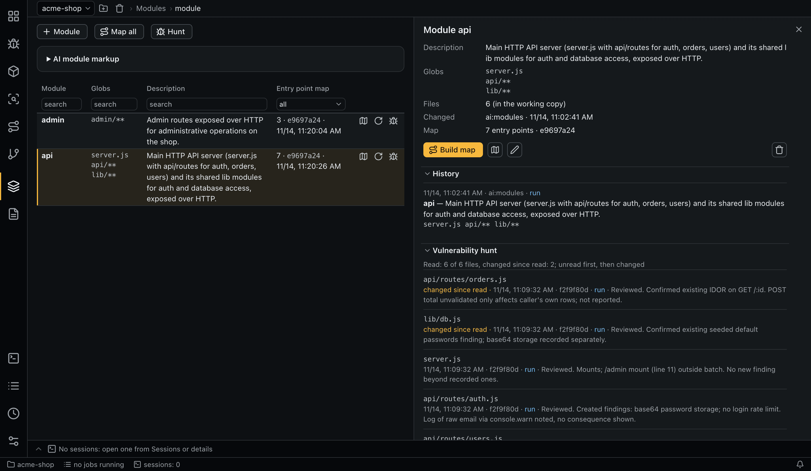

# Modules

A module is a name, a set of globs and a description. The globs define which files belong to the module; every per-module check (entry point maps, matrix verdicts, SCA, hunts) uses them.


## Globs

Globs are git pathspec globs, relative to the repository root:

- `*` does not cross `/`, `**` does;
- a leading `!` excludes;
- at least one including glob is required.

A module's files are the tracked files (`git ls-files`) that match. **Check globs** shows the count and a sample before saving. A glob that matches no file is rejected.

## Creating and changing modules

- **Module** adds a module by hand.
- **Mark up** under **AI module markup** runs the agent (role `modules`). Optional hints tell it which parts of the repository to cover and how to name modules. Markup doesn't overwrite manual edits; every change is a new revision.
- The details panel edits a module or deletes it; deletion requires a reason.

Revisions are append-only. The history in the details panel shows the author (`human` or `ai:modules`) and the run. Saving without changes creates no revision. Names are unique among live modules.

The project configuration can override a module's agent, model, instructions and permissions under `modules.<name>`, see the [cascade](configuration.md#the-cascade).

## Module columns and details

Table columns: name, globs, description, entry point map with its `stale` flag. The details panel adds the file count, revision history, effective configuration of the map task (module level included), **Build map** / **Rebuild map**, **Open map**, and **Watch output** while a job runs.

**Map all** queues a map for every module.

## Vulnerability hunt

The matrix checks only what the requirements name. **Hunt** looks for any exploitable flaw: sessions of the role `hunt` read every file of the module and record findings without a requirement. The toolbar button covers the filtered modules, the row button one module.

The file list is the module's files minus `hunt.exclude` (by default tests, vendored and generated code, docs), split into sessions of `hunt.batch_files` files. The run starts with an [estimate](queue-and-sessions.md); for a module without an entry point map the estimate warns and offers **Build maps**.

A session marks each file it has finished with `mark_files_reviewed`. If a run exits normally with files left unread, it fails, and **Retry** reads only those files.

Hunt findings (`create_hunt_finding`) require `find_similar` first, belong to the module, have no matrix cells and usually include a [data flow](findings.md#fields). Status is set by a person, as for any finding.

By default a hunt reads files never read and files changed since their last read (different content between the commit they were read at and HEAD). **Read every file again** above the estimate, or `--all`, reads all of them.

The **Vulnerability hunt** section in the module details lists each file with its last read time, commit, the session's note and a **changed since read** mark, unread files first, then changed ones.



Sessions of one module run sequentially so each sees the previous session's findings; different modules run in parallel. A module that already has a hunt in the queue is skipped.

## Command line

```bash
aiegis module list
aiegis module preview 'api/**' '!api/test/**'
aiegis module save api --glob 'api/**' --glob 'lib/**' --description 'Public API'
aiegis module parse --hint 'Two modules: api and admin'
aiegis module history <module>
aiegis module hunt api            # estimate, confirm, queue: unread and changed files
aiegis module hunt api --all      # every file again
aiegis module remove <module> 'Merged into api'
```

See the [CLI reference](cli.md#module).
