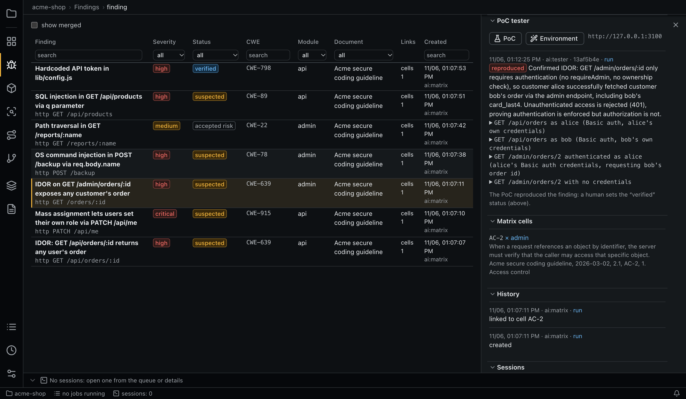

# PoC tester

The PoC tester tries to reproduce a `suspected` finding against a running test instance, with requests only to that instance. Its result is evidence for you; it does not change the finding's status.



## The test environment

The environment belongs in the project configuration. Without it, the tester is unavailable and the button says why.

```yaml
# <repo>/.aiegis/config.yaml
poc:
  environment:
    start: npm ci --silent && PORT=3100 node server.js
    healthcheck: curl -sf http://127.0.0.1:3100/health
    stop: ""
    base_url: http://127.0.0.1:3100
    accounts:
      alice: { username: alice, role: customer, tenant: a, secrets: { password: { env: POC_ALICE_PASSWORD } } }
      admin: { username: admin, role: admin, secrets: { password: { keychain: { service: aiegis-poc, account: admin } } } }
```

- `start`, `healthcheck` and `stop` run with `sh -c` in the worktree. `start` may stay in the foreground or exit after starting the service.
- `base_url` must be `http` or `https`.
- Accounts may have `username`, `role`, `tenant`, `notes` and `secrets`.

**Secrets** come from the app's environment or the macOS keychain, never from the file. They reach the instance and the tester as `AIEGIS_POC_<ACCOUNT>_<SECRET>`, and the prompt names only the variables. A missing secret fails the job. On Linux there is no keychain, so use `env`.

Commands and the tester inherit only `poc.env_passthrough` from the app's environment. The cascade's `env` level, account secrets, `AIEGIS_POC_BASE_URL` and `AIEGIS_POC_SCRIPTS` are added on top. Add what your build needs, such as `JAVA_HOME`, in the project configuration.

## Letting an agent set it up

**Environment** starts `env-setup`, a role that works out how to start the project:

1. It studies the code, docs, `AGENTS.md`/`CLAUDE.md`, skills and build files in a worktree, and reads your checkout too, for local files git ignores. It is told not to write there.
2. It calls `set_poc_environment`: commands replace `poc.environment` in `.aiegis/config.yaml`, keeping accounts, other keys and comments, and scripts go to `<repo>/.aiegis/poc/`. Leaving out `stop` keeps the current one; an empty string removes it.
3. It tests with `check_poc_environment` (`start`, `status`, `stop`), reads its service's logs while waiting, fixes problems and tries again. One polling call waits at most `poc.check_wait_max_sec`.

The session is done when its last check of the current environment is `ready`. Otherwise the app runs `start`, `healthcheck`, `stop` itself after the session, and the job fails if that does not work.

The output of a failed start (tester or env-setup) is saved and given to the next env-setup session. The output shown to the agent is its first 40 and last 80 lines, cut to 400 characters each, with repeated lines collapsed. You start the next attempt yourself.

> **Trust:** env-setup is not sandboxed. It has unrestricted `Bash` for builds and remote commands, but no account secrets, no `Edit`/`Write`, and only `poc.env_passthrough` of your environment. Its `check_poc_environment` calls do start the instance with secrets.

## Running the tester

The **PoC** button in a finding's details runs the tester. It is available on a live finding in the `suspected` status, with one active job per finding. For the job, the app:

1. creates a worktree of `HEAD` under `poc-worktrees/<sha>` (its build writes there);
2. runs `start`, and polls `healthcheck` every `healthcheck_interval_sec` until it exits 0 or `start_timeout_sec` passes;
3. runs the agent (role `tester`), with its scripts in `.aiegis-poc/<job-id>/`;
4. runs `stop` (up to `stop_timeout_sec`) and kills what remains of the `start` process group.

If the instance does not start, the run fails without calling the agent. The instance's output goes to the run's stream. Testers and env-setup share one instance per project, so they run one at a time.

## Results

`reproduced`, `not_reproduced` or `inconclusive`. The first two need the steps taken and the responses observed. `reproduced` means the effect the finding claims; when the tester could only show something weaker, it reports `inconclusive` and says what it showed. Results are append-only and record the commit, `base_url`, run and author. A successful run with no result ends in an error. After `reproduced`, the panel reminds you that a person sets the `verified` status.

## Isolation

| Layer | Claude Code | pi |
|---|---|---|
| OS sandbox | `poc.claude_settings`, passed with `--settings` | `poc.pi_sandbox`, applied by the aiegis extension |
| Engine | Seatbelt on macOS, bubblewrap on Linux | The same, through `@anthropic-ai/sandbox-runtime` |
| Network | The `base_url` host is added to the allowlist | Same |
| Writes | Only the working tree, and tool writes only to `.aiegis-poc/` | Only the working directory |
| Hook | A `PreToolUse` hook refuses commands addressing other hosts, redirection options of `curl` and `dangerouslyDisableSandbox` | The same hook runs before each `bash` command |
| No sandbox available | `failIfUnavailable` stops the session | Commands are blocked |

The tester's tools are `Read`, `Grep`, `Glob`, the MCP server, `Edit` and `Write` in `.aiegis-poc/`, and `Bash` limited to `git log`, `git show`, `ls`, `mkdir`, `curl`, `jq`, `python3`, `node`, one simple command per call.

**Local instances differ by agent:**

- **Claude Code** on macOS needs `allowLocalBinding: true`, which is on by default, to reach `localhost`. Scripts can then reach any port on `localhost`, including the aiegis MCP server, which needs a token. The internet stays closed, and the hook limits `curl` URLs to `base_url`. On Linux, requests go through the sandbox proxy, which allows only `base_url`.
- **pi** goes through the sandbox proxy, so exactly the `host:port` of `base_url` is open.

## Linux

The sandbox needs `socat` and `bubblewrap`. On Ubuntu 24.04, an AppArmor profile is also needed, or `bwrap` fails with `Failed RTM_NEWADDR: Operation not permitted`:

```bash
sudo apt install bubblewrap socat
printf 'abi <abi/4.0>,\ninclude <tunables/global>\n\nprofile bwrap /usr/bin/bwrap flags=(unconfined) {\n  userns,\n  include if exists <local/bwrap>\n}\n' | sudo tee /etc/apparmor.d/bwrap
sudo apparmor_parser -r /etc/apparmor.d/bwrap
```

The service's user needs `bash` as its shell. On Windows without WSL2, `failIfUnavailable` prevents tester sessions from starting.

## Command line

```bash
aiegis poc setup            # env-setup
aiegis finding poc <finding>
```
