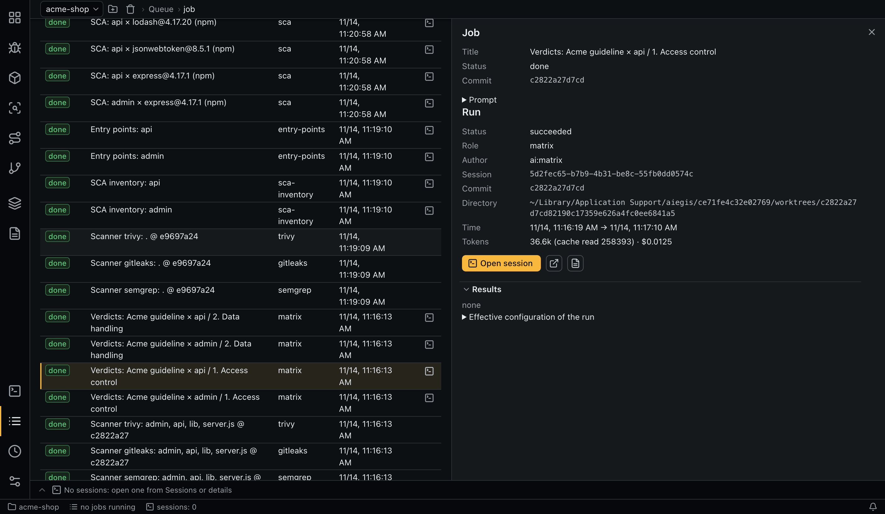
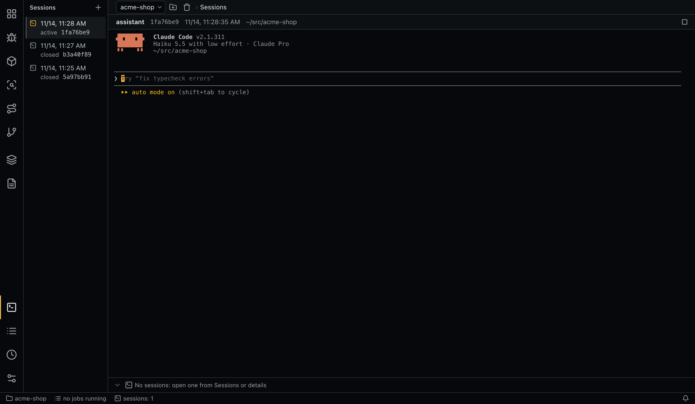

# Queue and sessions

All background work goes through one queue shared by all projects.



## Jobs and runs

A job is a queue entry. A run is one execution of a job or one opening of an interactive session; a retried job has several runs.

| Job status | Meaning |
|---|---|
| `queued`, `running` | Waiting, working |
| `done`, `failed`, `cancelled` | Finished |
| `taken_over` | Stopped so that you could continue it interactively |

| Run status | Meaning |
|---|---|
| `running`, `succeeded`, `failed`, `cancelled` | As named |
| `rate_limited` | Stopped by a provider limit; the job goes back to the queue |
| `token_limit` | Stopped at the configured limit |
| `refused` | The model declined the task (the provider's safety filter); the job fails and is not retried automatically; `queue.pause_after_refusals` declined runs in a row pause the queue for `queue.refusal_pause_sec` |
| `taken_over` | Stopped for an interactive session |
| `exited` | An interactive session ended |
| `interrupted` | The app stopped during the run |

Database triggers forbid updating a finished run or deleting any run. After a crash, `running` jobs return to `queued` and unfinished runs become `interrupted`.

The **Sessions and runs** table lists runs. Run details: job, role, status, commit, directory, session, tokens, cost, prompt, results, error, log, effective configuration.

## Limits

| Setting | Effect |
|---|---|
| `queue.parallelism` | Concurrent jobs, default 2. Read only from the global configuration |
| `limits.max_tokens_per_run` | Stops a run above the limit. Counts input, cache creation and output tokens, not cache reads |
| `limits.max_tokens_per_document_run` | The same limit for document reading, extraction and document checks |

## Rate limits

On a provider rate limit the job returns to the queue and the queue pauses until the reset time, or for `queue.rate_limit_fallback_pause_sec` if the reset time is unknown. **Continue** resumes earlier. pi doesn't report a reset time and always gets the fallback pause.

## Background tasks

**Background task** queues an arbitrary prompt with a role (default `sessions.default_task_role`) and an optional title, as an ordinary job.

## Sessions tab



The **Sessions** tab holds the project's free agent sessions. The list on the left shows start time, active/closed state and an id prefix for each; `⌘B` hides it. The selected session's terminal fills the main area under a line with role, session id, start time and working directory.

| Control | Action |
|---|---|
| **New session** (`+` above the list) | Interactive session of `sessions.free_role` in the working directory, with the aiegis MCP server and `manage` access: reads all project data, starts checks, edits code |
| **Stop the session** | Ends a live session after confirmation |
| **Continue** | Resumes a closed session in the same terminal |
| **Open in an external terminal** | Resumes it outside the app |

The context menu of a session also has **Rename** (the name replaces the start time and is stored per machine), **Copy the session id** and **Copy the working directory**.

Job runs and runs tied to findings, cells and other items aren't listed here; they open from **Queue** or the details panel.

## Sessions

**Open session** continues any run's session in its working directory (`claude --resume` or `pi --session-id`) with the same scope, recreating the worktree from its commit if needed. Each opening is a separate interactive run linked to its parent.

**Open in an external terminal** uses `terminal.external_app` on macOS. The app doesn't track that process: the run is recorded as finished immediately, its MCP token stays valid until the app exits, and it can't write an entry point map.

A session can only be continued by the agent that created it.

A live background process shows read-only output. **Take over into an interactive session** stops it and reopens the session interactively.

A commit made by a session in the working directory triggers a [recheck offer](matrix.md#rechecking-after-a-fix).

Interactive sessions exist only in the desktop app, not in the [service](service.md).

## Terminal panel


Tabs hold read-only streams (**Watch output**) and interactive sessions. The session selected on **Sessions** renders on that tab, not in the panel. Closing the tab of a live session ends its process after confirmation. The panel keeps up to `terminal.keep_ended_streams` ended streams in memory and drops the oldest; their logs stay on disk.

`⌘J` toggles the panel; a double-click on the tab bar maximizes it.

| Target | Action |
|---|---|
| Tab, context menu | Close, Close others, Close to the left, Close to the right, Close finished (process ended), Close all; Rename; Show the run (details in **Queue**); Open in an external terminal (ended interactive session); Copy the run id. Closing several tabs asks once and lists the live processes that will end |
| Tab, middle click | Close |
| Tab, drag / double-click on title | Reorder / rename. Names and order last until restart |
| Empty tab bar, context menu | New session, Close finished, Close all, maximize or restore, show or hide, move right or bottom |
| Output, context menu | Copy, Paste (live interactive sessions), Select all, Find, Clear |
| `⌘F` / `⌘K` | Find in output (`Enter` next, `Shift+Enter` previous, `Esc` close) / clear output. On Windows and Linux: `Ctrl+Shift+F` / `Ctrl+Shift+K`, so `Ctrl+F` and `Ctrl+K` reach the program |
| Links in output | URLs open in the browser; `path/to/File.java:42` opens in VS Code relative to the project root |

## Command line

```bash
aiegis job list
aiegis job add 'Summarize how sessions are stored' --role task --title 'Sessions'
aiegis job cancel <job>
aiegis job retry <job>
aiegis queue state
aiegis queue resume
aiegis run list
aiegis run show <run>
aiegis watch <job>          # output until it ends; Ctrl+C only stops watching
aiegis watch                # the feed of job statuses and notifications
aiegis terminal list
aiegis terminal show <terminal>
aiegis terminal close <terminal>
```
