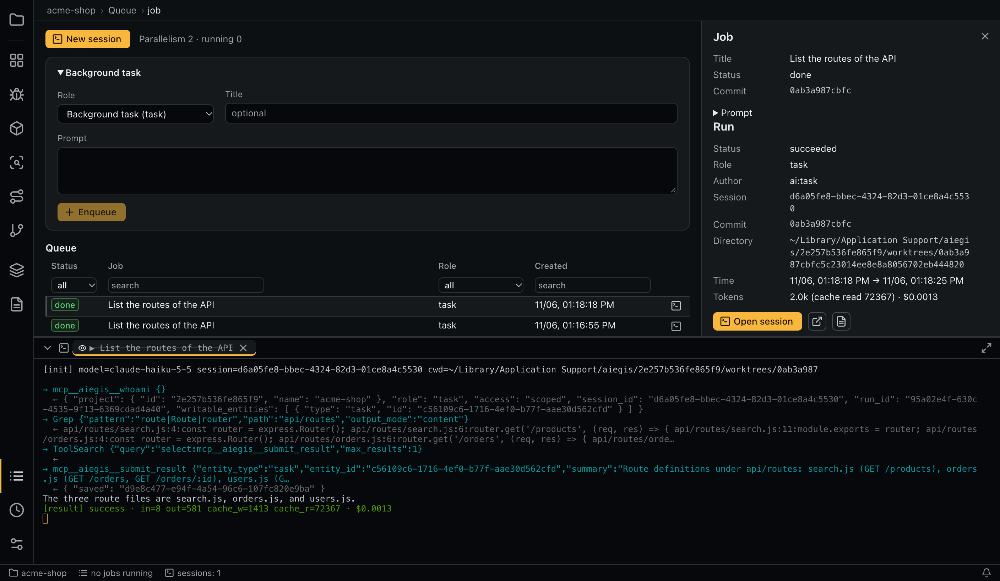

# Queue and sessions

All background work goes through one queue, shared by all projects.


## Jobs and runs

A **job** is a queue entry. A **run** is one execution of a job or one opening of an interactive session, and a job that is retried has several runs.

| Job status | Meaning |
|---|---|
| `queued`, `running` | Waiting, working |
| `done`, `failed`, `cancelled` | Finished |
| `taken_over` | Stopped so that you could continue it interactively |

| Run status | Meaning |
|---|---|
| `running`, `succeeded`, `failed`, `cancelled` | As named |
| `rate_limited` | Stopped by a provider limit; the job goes back to the queue |
| `token_limit` | Stopped at the configured limit |
| `taken_over` | Stopped for an interactive session |
| `exited` | An interactive session ended |
| `interrupted` | The app stopped during the run |

Runs are permanent: database triggers forbid changing a finished run or deleting one. After a crash, `running` jobs return to `queued` and unfinished runs become `interrupted`.

The **Sessions and runs** table lists runs. A run's details show the job, role, status, commit, directory, session, tokens, cost, the prompt, the results, the error, the log and the effective configuration.

## Limits

- `queue.parallelism` sets how many jobs run at once. The default is 2, and it is read only from the global configuration.
- `limits.max_tokens_per_run` stops a run over the limit, counting input, cache creation and output tokens but not cache reads. Reading documents, extraction and document checks use `limits.max_tokens_per_document_run`.

## Rate limits

When a provider limit is hit, the job returns to the queue and the queue pauses until the reset time, or for `queue.rate_limit_fallback_pause_sec` when the time is unknown. **Continue** resumes it early. pi does not report a reset time, so it always uses the fallback.

## Background tasks

**Background task** queues any prompt with a role (default `sessions.default_task_role`) and an optional title. It runs as a job like any other.

## Sessions

- **New session** opens a free interactive session of `sessions.free_role` in your working directory, with the aiegis MCP server and `manage` access. It can read all project data and start checks, and it can edit your code.
- **Open session** continues any run's session in its working directory (`claude --resume` or `pi --session-id`), with the same scope. The worktree is recreated from its commit if needed. Each opening is a separate interactive run linked to its parent.
- **Open in an external terminal** uses `terminal.external_app` on macOS. Its process is not tracked, so the run is recorded as finished at once, and its token lives until the app exits. It cannot write an entry point map.
- A session continues only with the agent that created it.

While a background process is alive, its output is shown read-only. **Take over into an interactive session** stops it and opens it interactively.

If a session in your working directory makes a commit, the app [offers to recheck](matrix.md#rechecking-after-a-fix) what it affected.

Interactive sessions exist only in the desktop app, not in the [service](service.md).

## Terminal panel



Tabs hold read-only streams (**Watch output**) and interactive sessions. Closing a tab of a live session ends its process, after a confirmation. Ended streams stay available up to `terminal.keep_ended_streams`, after which the oldest leave memory; their logs stay on disk.

`⌘J` shows or hides the panel, and double-clicking the tab bar maximizes it.

## Command line

```bash
aiegis job list
aiegis job add 'Summarize how sessions are stored' --role task --title 'Sessions'
aiegis job cancel <job>
aiegis job retry <job>
aiegis queue state
aiegis queue resume
aiegis run list
aiegis run show <run>
aiegis watch <job>          # output until it ends; Ctrl+C only stops watching
aiegis watch                # the feed of job statuses and notifications
aiegis terminal list
aiegis terminal show <terminal>
aiegis terminal close <terminal>
```
