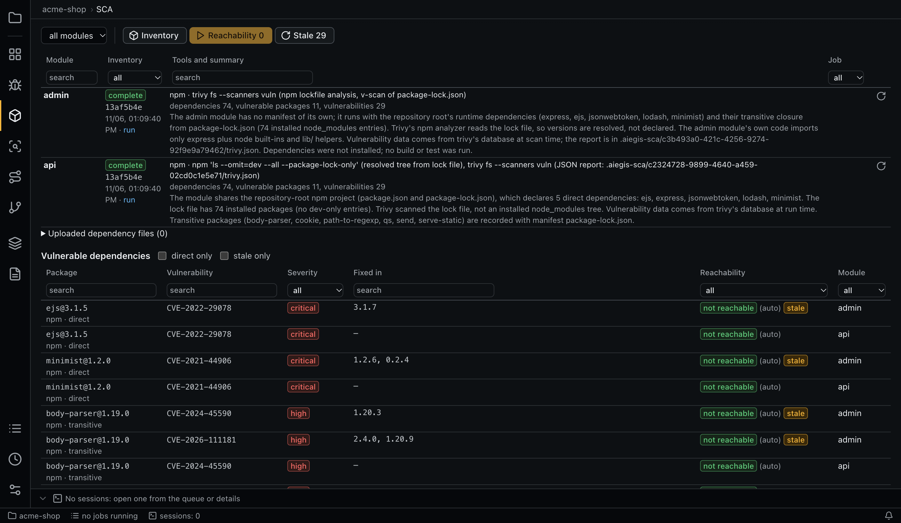
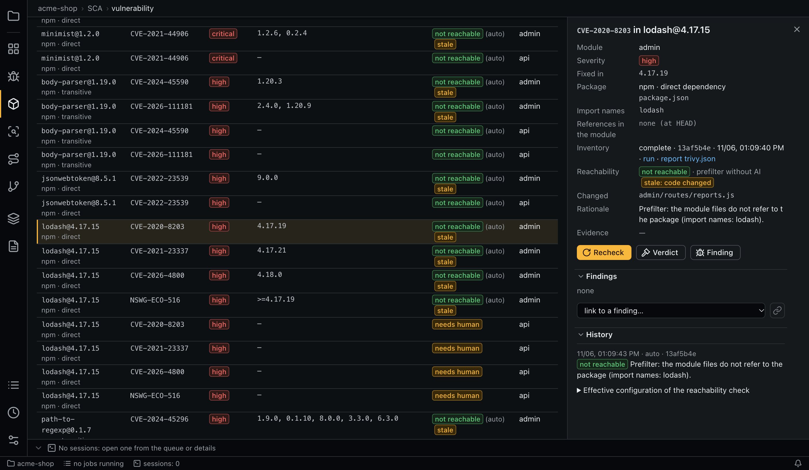

# SCA

SCA answers one question: does this module actually use a vulnerable dependency in the way the vulnerability needs? An SCA item is module × package@version × vulnerability.



## Inventory

An agent (role `sca-inventory`) builds each module's list of vulnerable dependencies. The app assumes no language or tool: the agent picks them, such as `npm audit`, Gradle with lock files, `trivy`, `osv-scanner`, `grype` or `govulncheck`. It also takes into account:

- files you upload (lock files, SBOMs, scanner reports), for one module or the whole project; these go to the next run;
- dependency CVEs from your [scanners](signals.md), as hints (`sca.scanner_hints_limit`).

**Inventory** at the top starts a run for all modules or the module chosen in the selector, and the button on a module row repeats it for that module. It works in its own worktree, because build tools write to the checkout, and the agent keeps its files in the run's directory, `.aiegis-sca/<job-id>/`.

### Protection against invented results

`add_vulnerable_package` is accepted only when:

- its report is a file inside the run's directory, within `sca.report_max_mb`;
- the report contains the package name (or its artifact without the group), the version, and each vulnerability or an alias of it;
- the manifest exists.

The report is stored and linked from the item, so you can open it. A run must finish with `set_inventory_summary`: the ecosystems, tools, number of dependencies checked, and manifests the result depends on. Otherwise the run ends with an error, and **Retry** continues it. A summary with no tools is refused, and manifests must be tracked by git. If dependencies could not be resolved, the agent records no summary, so an unfinished inventory never looks clean.

### Building elsewhere

The role's allowlist covers common build and audit tools, and package caches go through `permissions.dirs`. To resolve dependencies on a build server instead, extend the role in the project configuration:

```yaml
roles:
  sca-inventory:
    permissions:
      allow: ["Bash(ssh build-host:*)"]
    instructions: "Resolve dependencies on build-host, then scan the copied lock file locally."
```

> **Trust:** building runs the project's build scripts on your machine. Inventory the repositories you trust, or restrict this role. See [Security](security.md#what-is-not-isolated).

## Prefilter

Before any AI, the app searches the module's files at `HEAD` for each package's import names, with identifier boundaries. The inventory agent supplies those names: Java packages, the npm name, a Python module. Binary files and files over `sca.prefilter_max_file_kb` are skipped.

- No references: a `not_reachable` verdict with the author `auto`.
- References found: they go into the reachability prompt.
- No import names known: the AI decides.

## Reachability

**Reachability** (unchecked items), **Stale** (stale items) and **Recheck** on an item start a run. The selector at the top limits a run to one module; by default it covers all modules. The estimate shows how many items the prefilter closes, the AI sessions (one per module × package) and the tokens, from the last `sca.estimate_history_runs` runs of the role or `sca.estimate_tokens_per_package`. Items already queued are skipped.

| Verdict | Needs |
|---|---|
| `reachable` | Evidence and a linked finding |
| `not_reachable` | Evidence of how the package is used |
| `needs_human` | A reason |

Runs are atomic per vulnerability: **Retry** takes only the vulnerabilities with no verdict.

## Freshness

- A verdict becomes `stale` when the module's files or the files it touched change: evidence, the package's manifest, or the finding's files.
- An inventory becomes `stale` when a manifest named in its summary changes.
- A new inventory gives a new set of items; verdicts are kept by module × package × vulnerability.

## The tab

- **Modules**: inventory status, commit, the `stale` mark, tools and summary, the last run's error, and a button to repeat the inventory.
- **Uploaded dependency files**: upload or exclude a file. Files are never deleted, and **show excluded** lists the excluded ones.
- **Vulnerable dependencies**: filter by module, status, `stale` only, severity, direct only, or search.



An item's details show the vulnerability, fixed version, package, manifest, import names, references in the module, the tool's report, the verdict and evidence, findings, **Link the finding to the item**, the manual **Verdict** and **Finding**, the history and the effective configuration. A finding also shows its linked SCA items.

## Command line

```bash
aiegis sca add-input ./package-lock.json --module api --note 'Production lock file'
aiegis sca remove-input <input>
aiegis sca inventory --module api
aiegis sca show
aiegis sca estimate --scope pending
aiegis sca run --scope stale
aiegis sca item <item>
aiegis sca verdict <item> not_reachable 'Only used in tests' --evidence test/setup.js:3
aiegis sca finding <item> --title '...' --description '...' --severity high
aiegis sca link <finding> <item>
aiegis sca report <report>
```
