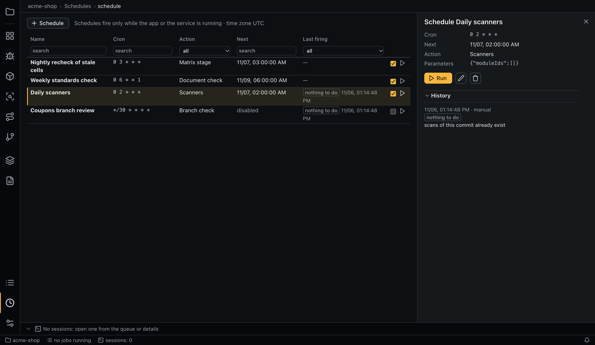
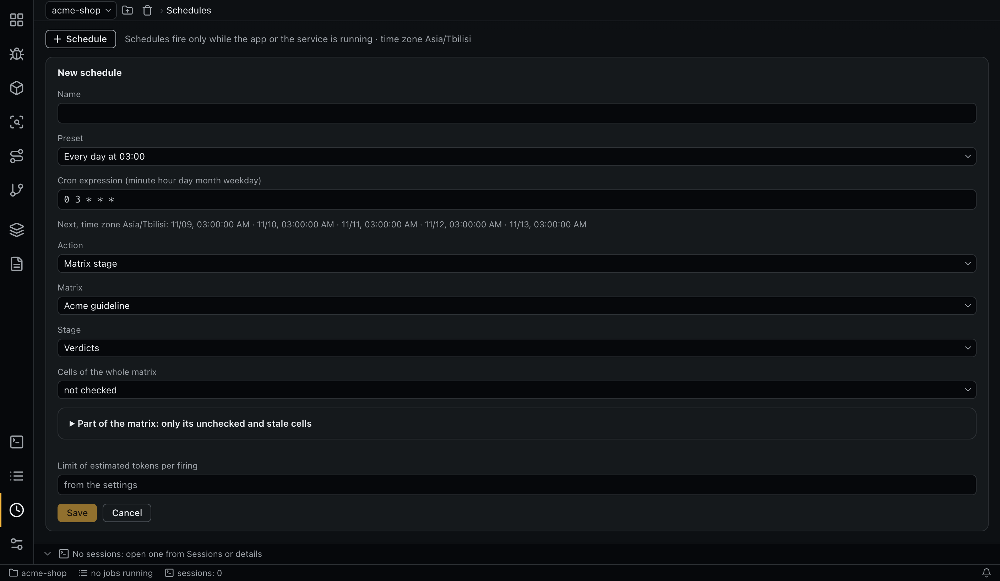

# Schedules

Schedules run audit actions on cron.



**Schedules fire only while the desktop app or the service is running.** To run them unattended, use the [service](service.md).

## Creating a schedule



A schedule has a name, a time, an action and optionally a token limit. It belongs to the project.

**Time:** a preset (every hour, every day at 03:00, every Monday at 03:00, first day of the month at 03:00) or a custom expression of five fields, `minute hour day month weekday`:

- `*`, lists, ranges and steps are supported, and weekdays are 0–7;
- when both the day of the month and the weekday are set, a match on either fires;
- the time zone is that of the OS;
- the form previews the next firings;
- an expression firing more often than `schedules.min_interval_minutes` is refused;
- there is no one-time schedule for a date.

**Actions:**

| Action | CLI value | Runs |
|---|---|---|
| Task | `task` | A free-form prompt with a role |
| Matrix | `matrix` | A whole matrix (triage or verdicts), or the verdicts of a part: modules, requirement keys, a section or cell ids |
| Scan | `scanners` | Scanners on modules or the whole repository |
| SCA inventory | `sca_inventory` | The inventory of modules |
| SCA reachability | `sca` | Reachability of unchecked or stale items |
| Entry points | `entry_points` | The map of one module or all modules |
| Document check | `doc_refresh` | A set or a document against its links |
| Branch check | `diff_check` | A branch against a set or a document |
| Fix checks | `fix_verify` | [Fix checks](findings.md#checking-a-fix) of the stale findings; with none, nothing runs and no tokens are spent |
| Vulnerability hunt | `hunt` | A [hunt](modules.md#vulnerability-hunt) in the chosen modules, or all: files not read yet and changed since read (every file with **Read every file again**, CLI `--all`); with none, nothing runs |

Part of a matrix takes only its unchecked and stale cells. It does not fall back to all cells, unlike the ▷ buttons. PoC runs, document plans, module markup and environment setup cannot be scheduled.

The table lists each schedule's name, cron expression, action, next time and last firing. A row has a checkbox to enable or disable it and a button to fire it now. Select a row for its parameters and history, with **Run**, edit and remove.

## How a firing is decided

A scheduler in the app's core looks for due firings every 15 seconds, so it survives sleep and clock changes. Each attempt gets a history record:

| Outcome | When |
|---|---|
| `started` | The action started |
| `missed` | The app was not running, and the firing is later than `schedules.catch_up_window_hours` |
| `overlap` | Jobs of the previous firing are still queued or running |
| `over_limit` | The estimate exceeds the limit (with a warning) |
| `nothing_to_do` | There is no work (no notification): for example, sources did not change, or the same branch state was checked |
| `failed` | An error (with a warning). No automatic retry, and the schedule stays enabled |

- **Catching up:** a firing missed by no more than the window runs once, however many were missed. Lateness counts from the newest missed time, so a nightly run still happens after a weekend with the computer off.
- **Disabling:** enabling a schedule or changing its expression recalculates the next time, so a disabled period does not count as missed. The first firing is counted from creation.
- **Token limit:** the schedule's own limit, or else `schedules.max_tokens_per_firing`. It applies to matrix, SCA, document check, branch check, fix check and hunt firings. Other actions cannot set one, and only `limits.max_tokens_per_run` constrains them.
- **Fire now:** the same checks as a planned firing, marked `manual`. The planned time does not move.
- **Removing:** the schedule is marked as removed and its firings stay in the history. There is no restore.

## Known behavior

- Closing the desktop app cancels the jobs of a running firing, and they are not repeated, because the firing already happened. In the service, jobs return to the queue.
- On the day clocks go forward, an expression that falls on the missing hour does not fire. When clocks go back, the repeated hour fires once.
- Schedules are available from the app and the command line, but not to agents over MCP.
- A task's prompt is not written to the logs.

## Command line

```bash
aiegis schedule preview '0 3 * * *'
aiegis schedule add --name nightly --cron '0 3 * * *' --action matrix --matrix main --stage verdicts --scope stale
aiegis schedule add --name scans --cron '0 2 * * *' --action scanners --repository
aiegis schedule add --name docs --cron '0 6 * * 1' --action doc_refresh --set <id> --max-tokens 200000
aiegis schedule add --name pr --cron '*/30 * * * *' --action diff_check --base main --head task-123 --set <id>
aiegis schedule add --name review --cron '0 9 * * 1' --action task --prompt 'Summarize the open findings' --role task
aiegis schedule list
aiegis schedule show <schedule>
aiegis schedule edit <schedule> --cron '0 4 * * *'     # --action replaces the whole action; --max-tokens default clears the limit
aiegis schedule disable <schedule>
aiegis schedule enable <schedule>
aiegis schedule run <schedule>
aiegis schedule history <schedule> --limit 20
aiegis schedule remove <schedule>
```
