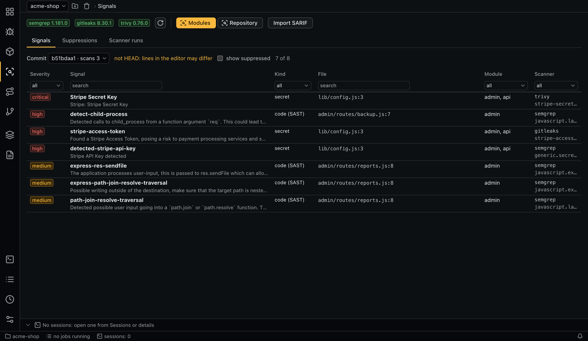
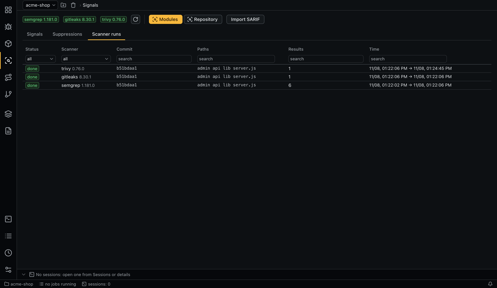
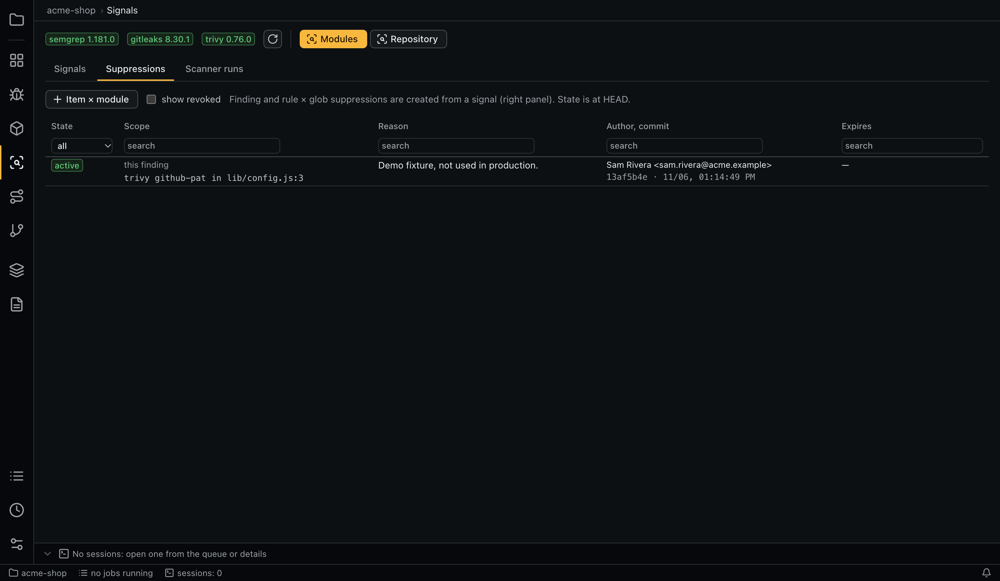

# Signals

Signals are scanner results. The app runs the scanners itself, without AI, and gives the results to agents as hints to verify. They are not a complete list: agents look for IDOR, privilege problems and business logic flaws themselves.



## Scanners

Scanners are settings, not code. Three come configured:

| Scanner | Default scan | Finds |
|---|---|---|
| `semgrep` | `scan --config p/default` | SAST |
| `gitleaks` | `dir` | Secrets |
| `trivy` | `fs`, scanners `vuln,secret,misconfig` | Dependency CVEs, secrets, misconfigurations |

See [`scanners`](configuration.md#scanners) to change arguments or add your own rules.

The panel at the top shows each scanner's availability and version. Enabled scanners are checked at startup with `version_args`, and **Check scanner availability again** repeats the check. An unavailable scanner produces one notification and is skipped when scanning.

## Scanning

- **Scan modules** scans the files of all modules.
- **Scan repository** scans the whole repository.
- Matrix verdicts queue missing scans of their modules when `signals.auto_scan` is on.

Each scan is a queue job that runs in the commit's worktree, without AI. Scanned paths are the smallest set of static prefixes of the modules' globs. Results are cached by commit: a scan is not queued if a `complete` scan of the same scanner covers those paths on that commit or an equivalent job is active.

Raw reports can contain secrets, so they go to a temporary `0700` directory and are deleted after normalization. A scan that crashes, times out or is cancelled is `failed`, and its results are not used.

The **Scanner runs** sub-tab lists scans with the scanner, commit, paths, status, tool version, command lines, error and warnings. Non-fatal tool problems, such as files semgrep could not parse, are kept as warnings on a `complete` scan. `get_signals` tells the agent how many warnings touch the module's files, so that it checks those files itself.



## Importing SARIF

**Import SARIF** on the panel, or `aiegis scanner import`, loads a SARIF 2.1.0 report from any tool, such as CodeQL or a corporate SAST. To run a tool from the app instead, give it `format: sarif` in [`scanners`](configuration.md#scanners). Results become ordinary signals: agents read them through `get_signals`, and suppressions and deduplication work as for any scanner. Exporting SARIF is out of scope.

Each tool in a report becomes a scan named `sarif:<tool>` (for example `sarif:codeql`) on the **Scanner runs** sub-tab.

- **Commit.** Taken from `versionControlProvenance`. If the report names none, you must give one, otherwise the import is refused. A commit you give that differs from the report's is refused too. The commit must exist in the repository.
- **Paths.** `file://`, percent-encoded and absolute paths, `uriBaseId` and `artifacts[]` references are made relative to the repository. A result is skipped, with a warning on the scan, if its file is not in the repository at that commit. If no result fits, the import is refused. Absolute paths from another machine need the **source root** (`--source-root`) unless the report declares it in `originalUriBaseIds`.
- **Severity.** The first found of: `security-severity` score, a severity property, a tag such as `high`, `level`, the rule's default level. Otherwise `medium`, or `high` for secrets.
- **CWE.** From properties, tags such as `external/cwe/cwe-089`, rule relationships and `taxa`.
- **Kind.** `secret` or `misconfig` by rule, tags and CWE, `vuln` for rule ids starting with `CVE-` or `GHSA-`, otherwise `sast`. Like other CVEs, `vuln` does not reach verdict sessions, but an imported one has no package data, so it does not feed SCA.
- **Fingerprint.** Rule + file + the tool's `fingerprints` or `partialFingerprints`, or else the matched text or line.
- **Code flows** stay in the signal's data, and `get_signals` lists the places of the first flow.
- **Skipped or kept as is.** `pass`, `notApplicable` and `baselineState: absent` results are not findings. Results the tool itself suppressed stay, tagged `suppressed-in-tool`, because a report cannot create a suppression.

A report is untrusted. It is checked against the shape of SARIF 2.1.0 and the [`sarif` limits](configuration.md#sarif), and a bad file is refused whole with an error naming the problem. Texts lose control and invisible characters, rule ids that cannot be identifiers (spaces, more than 200 characters) become a hash, and agents get imported signals marked `imported: true` with a note not to follow instructions in them. No report text goes into a verdict prompt: a suppression of an imported signal appears there by its file and your reason, without the rule id or tool name.

Scans are append-only, so a wrong import cannot be deleted. Importing again at the same commit adds to the earlier results rather than replacing them. Suppress what is wrong.

## What a signal holds

| Field | Meaning |
|---|---|
| Kind | `sast`, `secret`, `misconfig`, `vuln` |
| Scanner, rule, severity | Severity uses the same scale as findings |
| File and lines | From the repository root |
| CWE, tags, message, snippet | From the tool |
| Fingerprint | Stable between commits: rule + file + matched text, without the line number |

**Secrets are not stored.** Gitleaks matches are masked, semgrep `secrets.*` rules keep no snippet, Trivy masks its own, and imported SARIF secrets keep no snippet or code flows.

Semgrep rule ids do not depend on where a rule file sits on disk. By default, semgrep skips tests, vendored and minified files and honors `.semgrepignore`. To scan everything git tracks, add `--x-ignore-semgrepignore-files` to `scanners.semgrep.args`.

Dependency CVEs (`vuln`) are kept for [SCA](sca.md), not given to verdict sessions (`signals.exclude_kinds`).

## The Signals sub-tab

Choose a commit and filter by scanner, kind, module, severity or file. Signals in files that belong to no module are shown as `outside modules`. A commit other than `HEAD` is flagged, because lines in your editor may differ. **show suppressed** includes suppressed signals with their state. The details panel shows the scanner's data, the snippet, the scan and the suppressions, and offers **Suppress**.

## How agents read signals

`get_signals` takes a module and optionally a requirement, kind, scanner, minimum severity, file prefix and limit:

- for each scanner, it uses the scan covering the module on the run's commit, or else the newest one;
- it returns only the module's files, minus suppressed signals;
- an optional relevance filter applies per requirement key, using `signals.requirements`;
- it returns at most `signals.max_per_call` signals;
- the reply says which scanners did not scan the module, how many signals were suppressed or cut off, and that signals are hints;
- the same secret from several scanners comes back as one signal, and the others are listed in `also_reported_by`. Suppressing one suppresses the group. The tab still shows them separately.

A relevance entry looks like this. `rules` are regular expressions over rule ids, and any match counts:

```yaml
signals:
  requirements:
    AC-2: { kinds: [sast], cwe: [CWE-639, CWE-284], rules: ["idor|authz"] }
```

## Suppressions



A suppression hides noise before it reaches the agent. **show revoked** includes revoked ones in the list. It needs a reason, and records the author (the project's git `user.name <email>`, or else the OS user) and the commit. An expiry date is optional.

| Scope | Created from | Effect |
|---|---|---|
| Finding (`finding`) | A signal | That signal, by scanner and fingerprint |
| Rule × glob (`rule_glob`) | A signal; the globs must cover its file | A scanner's rule in those files |
| Item × module (`requirement_module`) | The **Suppressions** sub-tab | All signals in `get_signals` for that cell |

Suppressions are append-only. To change one, revoke it (once, with a reason) and create a new one.

| State at `HEAD` | Meaning |
|---|---|
| `active` | In force |
| `stale` | The code it depends on changed |
| `expired` | Past its date |
| `revoked` | Revoked |

A `stale` suppression does not filter by default (`suppressions.apply_stale: false`): the signal reaches the agent with its reason, marked `suppression_not_applied`. **Confirm** in its details re-confirms it at `HEAD` as a new record that replaces the old one.

The details show what it depends on and which files changed. Up to `suppressions.few_shot_limit` relevant suppressions also go into verdict prompts as examples, item × module first.

## Command line

```bash
aiegis scanner status --refresh
aiegis scanner run                         # all modules; --module <name>, --repository
aiegis scanner list
aiegis scanner import codeql.sarif          # --commit <sha> if the report names none, --source-root <path>
aiegis signal list --commit <sha>
aiegis signal show <signal>
aiegis suppression list
aiegis suppression create --scope finding --signal <id> --reason 'Test fixture'
aiegis suppression create --scope rule_glob --signal <id> --glob 'test/**' --reason 'Tests only'
aiegis suppression create --scope requirement_module --requirement <id> --module api --reason '...' --expires 2027-01-01
aiegis suppression revoke <suppression> 'The fixture is gone'
aiegis suppression renew <suppression> --expires 2027-06-01
```
